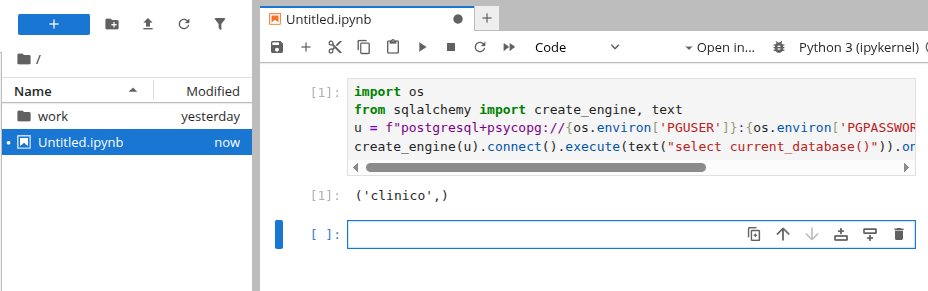

# Bitácora — Lab 07: stack clínico con Docker Compose

## Actividad 1 — El stack mínimo (Postgres + Adminer)

### Decisión: qué puertos se publican

Publicar un puerto (`"host:contenedor"`) abre el servicio en una interfaz de
mi máquina. Los servicios del mismo `compose.yml` se hablan por la red interna
sin publicar nada.

| Servicio | Puerto | ¿Publicado? | Por qué |
|---|---|---|---|
| Adminer | 8080 | Sí, como `127.0.0.1:8080:8080` | Lo necesito desde el navegador. Limitado al loopback: solo esta máquina lo ve. |
| Postgres | 5432 | **No** (por ahora) | Adminer llega por la red interna (`db:5432`), no hace falta abrirlo. |

**Por qué `127.0.0.1` y no `"8080:8080"`:** sin la IP, Docker publica en
`0.0.0.0`, es decir, en todas las interfaces. Cualquiera en mi red podría llegar
al panel y probar contraseñas. El 8080 es además un puerto muy escaneado.
Comprobación tras el `up`: `ss -ltn` muestra `127.0.0.1:8080`, no `0.0.0.0:8080`.

**Lo que `127.0.0.1` no cubre:** procesos de mi propia máquina, páginas web
maliciosas que usen el navegador para llegar a localhost, vulnerabilidades de
Adminer en sí, y contraseñas débiles. Por eso: contraseña larga y, en la
actividad 7, Adminer pasará a un perfil para que no esté siempre encendido.

**Después:** en la actividad 2 se publicó Postgres en `127.0.0.1:5432`, porque
exige conectarse desde fuera de Docker.

### Evidencia

Adminer conectado a la base `clinico` (System: PostgreSQL, Server: `db`):


### Problema encontrado: «password authentication failed»

- **Qué pasó:** cambié la contraseña en el archivo de variables después del
  primer `up` y Adminer dejó de poder entrar:
  `FATAL: password authentication failed for user "clinico"`.
- **Causa:** `POSTGRES_PASSWORD` solo se lee cuando se crea el volumen por
  primera vez. La contraseña queda guardada dentro de los datos, así que el
  cambio posterior se ignora.
- **Solución:** `docker compose down -v` y `up` de nuevo (el volumen estaba
  vacío, no se perdió nada). Con datos reales esto sería destructivo.
- **Otro error:** el campo *System* de Adminer venía en MySQL por defecto; hay
  que cambiarlo a PostgreSQL.

## Actividad 2 — Los servicios se hablan por nombre

### Qué se añadió

- Servicio `jupyter`, construido con `Dockerfile.jupyter`: imagen oficial
  `quay.io/jupyter/base-notebook:2026-10-12` + `psycopg[binary]`, `sqlalchemy` y
  `pandas`. Así las dependencias quedan escritas y no hay que hacer `pip install`
  a mano cada vez que se recrea el contenedor.
- Jupyter publicado solo en `127.0.0.1:8888` y protegido con token (`.env`).
- Postgres publicado ahora en `127.0.0.1:5432`: es lo que permite conectarme
  desde fuera de Docker. Sigue sin estar abierto a la red.
- La contraseña llega al notebook por variables de entorno (`PGHOST`, `PGUSER`,
  `PGPASSWORD`...), no escrita en el `.ipynb`.

### Las dos cadenas de conexión

| Desde dónde | Host | Cadena (sin contraseña) |
|---|---|---|
| Notebook (dentro de Docker) | `db` | `postgresql+psycopg://clinico:<clave>@db:5432/clinico` |
| Mi máquina (fuera de Docker) | `127.0.0.1` | `postgresql+psycopg://clinico:<clave>@127.0.0.1:5432/clinico` |

Comprobado: las dos devuelven la base `clinico` y llegan al mismo servidor
(`172.19.0.2`). Desde mi máquina, `db` no se resuelve (`getent hosts db` no
devuelve nada).

### Evidencia

Notebook dentro de Docker (host `db`):



Terminal en mi máquina (host `127.0.0.1`):


### ¿Por qué difieren?

Las cadenas difieren porque las conexiones se realizan desde dos contextos de red distintos, el 
primero es dentro de Docker, el cual crea una red interna para el stack, proporcionando un 
servidor DNS integrado. El segundo va por fuera de Docker, mi máquina física no forma parte de
la red interna de Docker, ni tiene acceso a su DNS.

### Comprobaciones de seguridad

- `ss -ltn`: los tres puertos (8080, 8888, 5432) escuchan en `127.0.0.1`.
- Jupyter sin token responde 403; con token, 200.

## Actividad 3 — Inicializar la base

### Qué se añadió

- Carpeta `initdb/` montada en `/docker-entrypoint-initdb.d` (solo lectura):
  - `01-esquemas.sql`: crea los esquemas `cdm` y `results`.
  - `02-tablas-prueba.sql`: crea `cdm.person` (subconjunto de columnas de la tabla
    `person` de OMOP, con datos inventados) y `results.conteo_pacientes`.
- Los prefijos numéricos importan: Postgres ejecuta los scripts en orden
  alfabético, y los esquemas tienen que existir antes que las tablas.

### Experimento: modificar un script y volver a hacer `up`

| Paso | Qué hice | Qué vi |
|---|---|---|
| 1 | `down -v` + `up -d` (volumen vacío) | Los logs mostraron la ejecución de los scripts. En Adminer aparecieron los esquemas creados y la tabla original con las primeras filas. |
| 2 | Añadí la fila `(5, 8532, 1990)` a `02-tablas-prueba.sql` y `up -d` | Docker Compose indicó que el contenedor estaba actualizado (Running / Up to date). No hubo cambios en la base de datos. |
| 3 | `up -d --force-recreate db` y `logs db` | PostgreSQL Database directory appears to contain a database; Skipping initialization |
| 4 | Consulté `cdm.person` | La fila 5 no estaba. La tabla seguía teniendo únicamente las filas originales. |
| 5 | `down -v` + `up -d` | La tabla ahora sí mostró la nueva fila (5), sumando el total esperado. |

### ¿Se aplicó el cambio? ¿Por qué?

No se aplicó tras el paso 2 ni el paso 3. Esto ocurre porque la imagen de Postgres evalúa el directorio de datos montado en el volumen (/var/lib/postgresql/data); si detecta que la base de datos ya fue inicializada previamente (el volumen no está vacío), omite por completo la lectura de la carpeta /docker-entrypoint-initdb.d/. Recrear el contenedor no sirve de nada si el volumen subyacente sigue intacto.

### ¿Qué hace falta para que se aplique?

Hace falta destruir el volumen persistente mediante la bandera -v (ej. docker compose down -v) para que, al volver a arrancar, el directorio de datos esté vacío y se vuelva a disparar el proceso de inicialización. Lo que se pierde al hacer esto es absolutamente toda la información y estado de la base de datos: es un borrón y cuenta nueva, destruyendo cualquier dato que se haya insertado o modificado manualmente después de la primera creación.

## Actividad 4 — Persistencia: qué sobrevive y qué no

### Qué se añadió

- Bind mount `./notebooks:/home/jovyan/work` en el servicio `jupyter`. La carpeta
  `notebooks/` de mi máquina es la carpeta de trabajo de Jupyter.
- Los datos de Postgres siguen en el volumen con nombre `pgdata`.

### Datos de prueba que inserté

Inserté manualmente la fila `(6, 8507, 1965)` en la tabla `cdm.person` utilizando la consola SQL de **Adminer**. Antes de ejecutar los comandos de prueba, la tabla contaba con 6 filas en total (las 5 iniciales generadas por el script `initdb` más esta nueva inserción manual).

### Tabla de persistencia

| Comando | ¿Sobreviven los datos? | ¿Por qué? |
|---|---|---|
| `docker compose restart` | Sí, la fila 6 sigue ahí. | Los contenedores no se eliminan, solo se reinician sus procesos internos. Los datos persisten intactos en el volumen `pgdata`, el cual ni siquiera se toca durante un reinicio. |
| `docker compose down` + `up` | Sí, la fila 6 sigue ahí. | El comando `down` destruye los contenedores y la red, pero respeta los volúmenes. Al levantar el *stack* nuevamente con `up`, el nuevo contenedor de Postgres se conecta al volumen `stack_pgdata` existente y recupera todos los datos. |
| `docker compose down -v` + `up` | No, la fila 6 desaparece y la tabla vuelve a sus 5 filas iniciales. | El flag `-v` instruye a Docker para que también destruya los volúmenes con nombre. Al hacer `up`, el contenedor encuentra el directorio de datos vacío y vuelve a ejecutar los scripts de `initdb` desde cero (que solo contienen las filas 1 a 5). Este es el mismo mecanismo observado en la actividad 3. |

### Bind mount para los notebooks

El *bind mount* permitió la sincronización bidireccional inmediata en la misma ruta:
- Al crear el archivo `Untitled.ipynb` desde la interfaz web de Jupyter, este apareció instantáneamente en la carpeta local `./notebooks/` de mi máquina (siendo mi usuario local el dueño).
- Al crear o editar el archivo `hola.py` directamente desde mi editor local en `./notebooks/`, los cambios se reflejaron de inmediato en la carpeta `work/` dentro de Jupyter.
- Todo esto ocurrió **sin necesidad de reconstruir la imagen ni reiniciar el contenedor**, porque ambas rutas apuntan exactamente al mismo directorio físico en el disco; no hay copias de por medio.
- Los permisos fluyeron sin problemas porque, por casualidad en este entorno, mi UID local y el UID del usuario `jovyan` dentro del contenedor coinciden (ambos son `1000`).

### ¿Qué diferencia hay entre el volumen `pgdata` y el bind mount de `notebooks/`?

La diferencia fundamental es **quién los administra y cómo reaccionan al ciclo de vida de Docker**:

- El **volumen con nombre (`pgdata`)** es administrado 100% por Docker. Está oculto en el sistema de archivos interno de Docker, optimizado para el rendimiento de bases de datos y evita problemas de permisos cruzados. Sin embargo, su ciclo de vida está atado a Docker: al ejecutar `docker compose down -v`, **se borra irreversiblemente**. Es ideal para el "estado interno" de un servicio.
- El **bind mount (`./notebooks`)** es una carpeta local administrada por el sistema operativo del *host*. Es ideal para código o archivos que quiero editar en tiempo real con mis propias herramientas. Lo más importante: al ejecutar `docker compose down -v`, **Docker no toca ni borra esta carpeta**. Tras comprobarlo haciendo un `down -v` + `up -d`, confirmé que mis archivos `Untitled.ipynb` y `hola.py` sobrevivieron intactos, a pesar de que los datos de Postgres se reiniciaron.


## Actividad 5 — Sincronización de servicios con healthchecks

### Qué se añadió

- **Healthcheck en el servicio `db`**: Se configuró para que cada 5 segundos ejecute `pg_isready -h 127.0.0.1 -U $$POSTGRES_USER -d $$POSTGRES_DB` (con `timeout: 3s`, `retries: 10` y `start_period: 10s`). Esto le pregunta activamente a Postgres si ya está aceptando conexiones.
- **`depends_on` con `condition: service_healthy` en `jupyter`**: Ahora Jupyter no arranca hasta que la base de datos reporte que está sana. Anteriormente solo esperaba a que el contenedor de `db` existiera.
- **Script `notebooks/conectar.py`**: Un pequeño script en Python que intenta conectarse a la base de datos sin reintentos y devuelve "OK" o "FALLÓ". Su propósito es medir y evidenciar el fallo de conexión.

### Cómo se provocó el fallo

Como Jupyter no se conecta a nada automáticamente al arrancar y la base de datos se inicializa en menos de un segundo, tuve que forzar la condición de carrera (*race condition*). El método consistió en destruir todo el estado, levantar el stack y ejecutar inmediatamente el script de conexión:
`docker compose down -v` + `docker compose up -d` y, de inmediato, `docker compose exec jupyter python conectar.py`.

### Resultados (Mediciones)

Aunque el enunciado menciona que este fallo puede ser intermitente en máquinas rápidas, al lanzar el `exec` pegado al `up`, el fallo fue sistemático:

| Configuración | Intentos | Conectaron a la primera | Qué vi en la consola |
|---|---|---|---|
| **Sin healthcheck** | 5 | 0 | `Connection refused` en todos los intentos, a pesar de que el log del `up` decía `Started` para `db`. |
| **Con healthcheck** | 5 | 5 | El comando `up` esperó hasta marcar la base como `Healthy` (~5.7 s) antes de siquiera arrancar el contenedor de Jupyter. Todas las conexiones fueron exitosas. |

Evidencia: `docker compose ps` con el stack levantado desde cero y el healthcheck activo:

```text
NAME              IMAGE           COMMAND                  SERVICE   CREATED         STATUS                   PORTS
stack-adminer-1   adminer:4       "entrypoint.sh docke…"   adminer   9 minutes ago   Up 9 minutes             127.0.0.1:8080->8080/tcp
stack-db-1        postgres:16     "docker-entrypoint.s…"   db        9 minutes ago   Up 9 minutes (healthy)   127.0.0.1:5432->5432/tcp
stack-jupyter-1   stack-jupyter   "tini -g -- start.sh…"   jupyter   9 minutes ago   Up 9 minutes (healthy)   127.0.0.1:8888->8888/tcp
```

### Por qué "arrancó" no significa "está listo"

- Para Docker, un contenedor en estado **Up (Started)** solo significa que su proceso principal (el PID 1) ya existe. 
- Sin embargo, Postgres tarda un tiempo adicional en inicializar su directorio de datos, ejecutar los scripts de la carpeta `initdb` y finalmente abrir el puerto para escuchar peticiones.
- Durante ese hueco temporal, Docker da el contenedor por arrancado y levanta a los dependientes (como Jupyter). Pero si un cliente intenta conectarse en ese instante, recibe un "Connection refused" porque la aplicación interna aún no está lista.
- El **healthcheck** soluciona esto cambiando la pregunta que hace Docker: pasa de *"¿existe el proceso?"* a *"¿la aplicación responde a lo que necesito?"*. Combinado con `depends_on: service_healthy`, obliga a los demás servicios a esperar esa confirmación.

### Detalles técnicos relevantes del diseño

- **El flag `-h 127.0.0.1` es a propósito**: Durante la inicialización (`initdb`), Postgres levanta un servidor temporal que solo escucha por socket Unix. Al medirlo en un contenedor desechable, el test por socket daba "OK" a los 0.49 s, pero por TCP tardaba 0.69 s (cuando ya escuchaba el servidor real). Si omitíamos el `-h`, el healthcheck podría haber dado "sano" prematuramente.
- **El doble dólar (`$$`)**: En `$$POSTGRES_USER` evita que Docker Compose intente sustituir la variable con los valores de mi máquina local antes de crear el contenedor. Así la resolución ocurre correctamente dentro del entorno de Postgres.
- **Dos orígenes de healthchecks**: Al hacer `docker ps`, noté que ambos contenedores decían `(healthy)`. El de Jupyter viene incluido "de fábrica" en la imagen base oficial que utilizamos, mientras que el de la base de datos lo escribí yo en el `docker-compose.yml`.
- **El coste**: Arrancar en orden tiene un precio. Hacer `up` tarda unos 5 segundos más (lo que coincide con el `interval: 5s` del healthcheck). Es el costo de asegurar que el sistema se levanta de forma determinista y sin errores de conexión.

## Actividad 6 — Configuración fuera del archivo

### Qué se movió a `.env`

- Ya estaban desde antes: `POSTGRES_USER`, `POSTGRES_DB`, `POSTGRES_PASSWORD` y
  `JUPYTER_TOKEN`.
- Ahora también los puertos del lado de mi máquina: `POSTGRES_PORT`,
  `ADMINER_PORT` y `JUPYTER_PORT`.
- Todas usan `${VAR:?mensaje}`: si falta alguna, `docker compose` se niega a
  arrancar con un mensaje claro, en lugar de levantar algo a medias.
- `127.0.0.1` se queda fijo en el `compose.yml` (no es variable): es una decisión
  de seguridad y no quiero que alguien la cambie por accidente a `0.0.0.0`. Los
  puertos internos (5432, 8080, 8888) tampoco son variables: no cambian.
- `.env` está en `.gitignore`; `.env.example` se versiona, con marcadores en lugar
  de valores reales y comentarios sobre cada variable.

### Comprobación: `grep -ri "password" compose.yml`

```text
      POSTGRES_PASSWORD: ${POSTGRES_PASSWORD:?falta POSTGRES_PASSWORD en .env}
      PGPASSWORD: ${POSTGRES_PASSWORD:?falta POSTGRES_PASSWORD en .env}
```

La salida no está vacía porque grep (con el flag -i para ignorar mayúsculas y minúsculas) encontró la palabra PASSWORD escrita en los nombres de las variables y en el mensaje de error de mi archivo.

### ¿Falla si falta una variable?

Sí falla, de forma inmediata. Quité `POSTGRES_PASSWORD` de un `.env` de prueba y el
texto que arrojó fue:

```text
error while interpolating services.db.environment.POSTGRES_PASSWORD: required variable POSTGRES_PASSWORD is missing a value: falta POSTGRES_PASSWORD en .env
error while interpolating services.jupyter.environment.PGPASSWORD: required variable POSTGRES_PASSWORD is missing a value: falta POSTGRES_PASSWORD en .env
```

## Actividad 7 — Un servicio opcional

### Qué se añadió

- `profiles: ["dev"]` en el servicio `adminer`. Sin esa bandera, `docker compose up`
  lo ignora; con `--profile dev`, se levanta.
- `db` y `jupyter` no tienen perfil: siempre se levantan.
- Motivo: Adminer es la pieza de más riesgo (panel de administración de la base) y,
  como decidimos en la actividad 1, no debe estar encendido todo el tiempo.

### Caso 1: `docker compose up -d` (sin perfil)

Al ejecutar el comando sin la bandera del perfil, la salida de `docker compose ps` solo mostró a los contenedores `db` y `jupyter` en ejecución; Adminer brilló por su ausencia. Consecuentemente, al abrir `http://127.0.0.1:8080` en el navegador, la página simplemente no cargó (error de conexión), confirmando que el puerto y el servicio estaban inactivos.

### Caso 2: `docker compose --profile dev up -d` (con perfil)

Al añadir la bandera al levantar el *stack*, la salida de `docker compose ps` mostró esta vez a los tres servicios (`db`, `jupyter` y `adminer`) activos: `db` y `jupyter` como `(healthy)` y `adminer` solo como `Up`, porque no tiene healthcheck. Compose no recreó `db` ni `jupyter`: solo arrancó Adminer. Al recargar `http://127.0.0.1:8080` en el navegador, la interfaz web de Adminer cargó correctamente, permitiendo el acceso a la base de datos.

### Un detalle al apagar: `down` y los perfiles

Si Adminer está corriendo e intentas apagar todo ejecutando un simple `docker compose down` (sin especificar el perfil), ocurre algo interesante: los servicios `db` y `jupyter` se apagan y eliminan correctamente, pero en la terminal aparece una advertencia amarilla sobre la red indicando `! Resource is still in use`. Compose termina sin lanzar un error fatal, pero no logra borrar la red.

**¿Por qué sucede esto?**
Docker Compose solo "ve" los servicios que pertenecen a los perfiles activos en ese momento. Al ejecutar `down` sin `--profile dev`, Compose ignora la existencia de `adminer` y no lo apaga. Sin embargo, al intentar destruir la red `stack_default`, el motor de Docker lo bloquea para proteger el sistema, ya que el contenedor de Adminer huérfano sigue conectado a ella.

**La solución:**
Debes usar la misma bandera de perfil tanto para levantar como para destruir el entorno. Ejecutar `docker compose --profile dev down` le indica a Compose que incluya a Adminer en la orden de limpieza, eliminando su contenedor y, ahora sí, liberando y borrando la red exitosamente.


## Actividad 8 — Depurar a propósito

### Cómo se rompió

Cambié `POSTGRES_PASSWORD` **solo en `.env`** (un único lugar) con el volumen `pgdata` ya creado, y ejecuté `docker compose up -d`.

- Compose recreó **los dos** contenedores (`db` y `jupyter`), porque la variable cambió en ambos.
- Postgres solo lee `POSTGRES_PASSWORD` al crear el volumen. Como el volumen ya tenía datos, **la base conservó la clave vieja** y Jupyter recibió la nueva.

### Paso 1 — `docker compose ps`

```text
stack-db-1        Up 20 seconds (healthy)
stack-jupyter-1   Up 15 seconds (healthy)
```

Ambos contenedores aparecieron como `healthy`. `pg_isready` solo comprueba que Postgres acepta conexiones; no autentica ni valida ninguna clave. Por eso el healthcheck marca `healthy` aunque la clave de Jupyter sea incorrecta: `ps` es ciego a este tipo de fallo.

### Paso 2 — `docker compose logs <servicio>`

- `logs jupyter`: solo el arranque normal del servidor (token, URL). Nada de error: Jupyter no se conecta a la base hasta que el notebook lo intenta.
- `logs db`:

```text
FATAL:  password authentication failed for user "clinico"
DETAIL:  Connection matched file ".../pg_hba.conf" line 128: "host all all all scram-sha-256"
```

El error está en el **servidor** de la base, no en el cliente. Al revisar los logs, la asimetría fue evidente:
- **El cliente calló:** `docker compose logs jupyter` no mostró ninguna línea de error. La conexión la abre el notebook cuando se ejecuta una celda, así que el servicio no registra nada; el error solo se ve en la salida (traceback) de quien intenta conectar.
- **El servidor habló:** `docker compose logs db` registró un `FATAL: password authentication failed for user "clinico"` por cada intento de conexión.

### Paso 3 — `docker compose exec <servicio> ...`

- `exec jupyter`: `PGHOST=db`, `PGUSER=clinico`, `PGPASSWORD` de 26 caracteres que empieza por `clave…` → el valor **nuevo**.
- `exec db`, conectando por red (`-h db`, la ruta de Jupyter): la clave **nueva** falla con `password authentication failed`; la **vieja** entra.
- Trampa: con `-h 127.0.0.1` o por socket Unix, `psql` entra **sin pedir clave**, porque `pg_hba.conf` tiene reglas `trust` para localhost y socket. Esa prueba no demuestra nada sobre la clave.

### Diagnóstico final

`.env` y la base quedaron desincronizados: Jupyter envía una clave que Postgres no tiene guardada, porque Postgres fijó la suya al crear el volumen. Cuando Compose recreó los contenedores, el servicio `jupyter` adoptó la nueva contraseña en su variable `PGPASSWORD` y empezó a usarla para intentar conectarse. Sin embargo, la imagen de Postgres tiene una regla estricta: **solo lee `POSTGRES_PASSWORD` la primera vez que inicializa un directorio de datos vacío**. Como el volumen `pgdata` ya existía e intacto, Postgres ignoró la nueva variable de entorno y siguió exigiendo la contraseña original.

**Dos formas de arreglarlo:**
1. Revertir `.env` al valor con el que se creó el volumen (no pierde datos).
2. Hacer que la base adopte la clave nueva: `docker compose down -v` y volver a levantar (**borra los datos**), o cambiarla sin perder datos con `ALTER USER clinico PASSWORD '...'` dentro de la base.

### Arreglo aplicado

Revertí `.env` al valor original y ejecuté `up -d`: `ps` mostró ambos `healthy` y la conexión desde Jupyter volvió a funcionar.

## Actividad 9 — La prueba real de reproducibilidad

### Prueba en clon limpio (hecha por mí, en mi máquina)

1. `docker compose --profile dev down -v`: borra contenedores, red y el volumen `pgdata` del stack original.
2. `git clone` del repositorio en otra carpeta (`~/Documentos/lab7-clon-limpio/`): el clon no trae `.env`, como debe ser.
3. `cp .env.example .env && docker compose up -d`, **sin ningún otro paso**.

Resultado (con los valores de ejemplo de `.env.example`):

- `db` y `jupyter` quedaron `healthy`; `up -d` tardó ~6 s porque las imágenes ya estaban en caché (una máquina sin caché tardará más).
- `initdb` se ejecutó: existen los esquemas `cdm` y `results` y las tablas `cdm.person` y `results.conteo_pacientes`.
- Jupyter se conectó a la base con las variables `PG*`.
- El bind mount mostró `Untitled.ipynb`, `conectar.py` y `hola.py`, y se pudo **escribir** desde el contenedor.
- Jupyter respondió HTTP 200 con el token; con `--profile dev`, Adminer respondió 200.

### Pasos manuales encontrados

Ninguno en el flujo. Sí había **requisitos implícitos** que no estaban escritos y ahora están en el `README.md`: Docker con Compose v2, puertos 5432/8888/8080 libres, uid 1000 para el bind mount, `--profile dev` también en `down`, y la advertencia de que la clave solo se lee al crear el volumen.

### Limitaciones de esta prueba

Mismo equipo, uid 1000 e imágenes en caché: no cubre otros uids, otros sistemas ni un primer build en frío. Por eso hace falta la prueba de un compañero.

### Reporte del compañero

[Pendiente: nombre o alias, sistema operativo, `id -u`, si necesitó algún paso fuera del README, errores y cuánto tardó. Pega aquí su reporte tal cual.]

Lista para pasarle:

1. `git clone <tu-repo>` y entrar en `s07-docker-compose/tu-entrega/stack`.
2. Seguir **solo** el `README.md` (las tres líneas).
3. Comprobar: `docker compose ps` (ambos `healthy`), abrir Jupyter con el token y ejecutar `psycopg.connect()`.
4. Anotar cualquier cosa que haya tenido que adivinar o preguntar.
