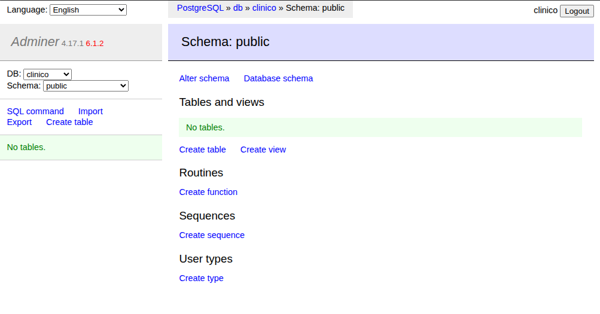

# Bitácora — Lab 07: stack clínico con Docker Compose

## Actividad 1 — El stack mínimo (Postgres + Adminer)

### Decisión: qué puertos se publican

Publicar un puerto (`"host:contenedor"`) abre el servicio en una interfaz de
mi máquina. Los servicios del mismo `compose.yml` se hablan por la red interna
sin publicar nada.

| Servicio | Puerto | ¿Publicado? | Por qué |
|---|---|---|---|
| Adminer | 8080 | Sí, como `127.0.0.1:8080:8080` | Lo necesito desde el navegador. Limitado al loopback: solo esta máquina lo ve. |
| Postgres | 5432 | **No** (por ahora) | Adminer llega por la red interna (`db:5432`), no hace falta abrirlo. |

**Por qué `127.0.0.1` y no `"8080:8080"`:** sin la IP, Docker publica en
`0.0.0.0`, es decir, en todas las interfaces. Cualquiera en mi red podría llegar
al panel y probar contraseñas. El 8080 es además un puerto muy escaneado.
Comprobación tras el `up`: `ss -ltn` muestra `127.0.0.1:8080`, no `0.0.0.0:8080`.

**Lo que `127.0.0.1` no cubre:** procesos de mi propia máquina, páginas web
maliciosas que usen el navegador para llegar a localhost, vulnerabilidades de
Adminer en sí, y contraseñas débiles. Por eso: contraseña larga y, en la
actividad 7, Adminer pasará a un perfil para que no esté siempre encendido.

**Pendiente:** Postgres se publicará en `127.0.0.1:5432` en la actividad 2, que
exige conectarse desde fuera de Docker.

### Evidencia

Adminer conectado a la base `clinico` (System: PostgreSQL, Server: `db`):

### Problema encontrado: «password authentication failed»

- **Qué pasó:** cambié la contraseña en el archivo de variables después del
  primer `up` y Adminer dejó de poder entrar:
  `FATAL: password authentication failed for user "clinico"`.
- **Causa:** `POSTGRES_PASSWORD` solo se lee cuando se crea el volumen por
  primera vez. La contraseña queda guardada dentro de los datos, así que el
  cambio posterior se ignora.
- **Solución:** `docker compose down -v` y `up` de nuevo (el volumen estaba
  vacío, no se perdió nada). Con datos reales esto sería destructivo.
- **Otro error:** el campo *System* de Adminer venía en MySQL por defecto; hay
  que cambiarlo a PostgreSQL.
