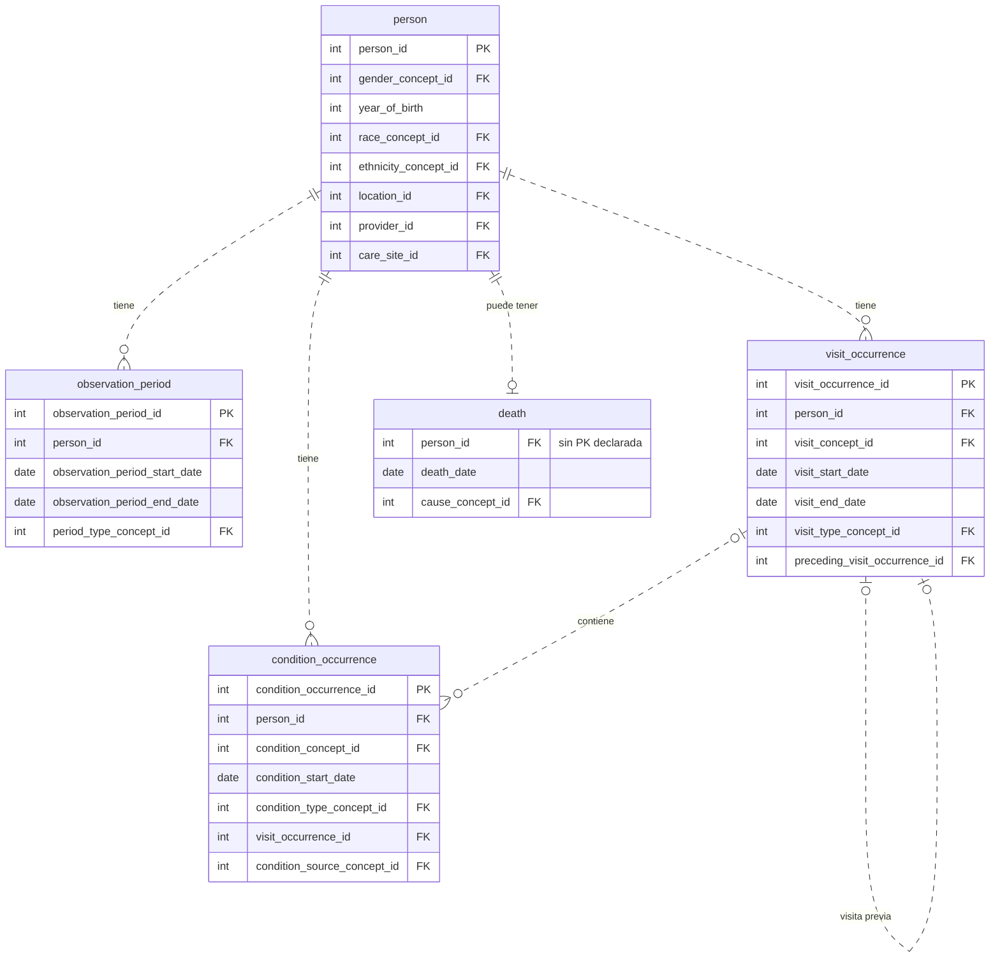
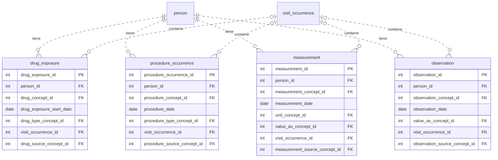
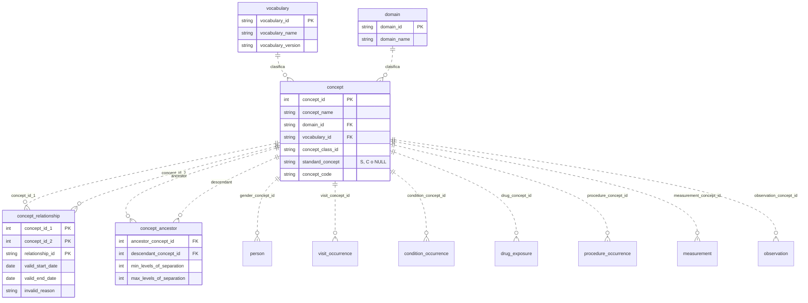

# Diagrama ER del CDM cargado (esquema `cdm`)

Generado a partir de `information_schema` de la base `omop_lab12`, no de la documentación.
Se muestran las llaves (PK/FK) y las columnas principales; se omiten las `*_source_value`
y las columnas de datetime para mantenerlo legible.

Convenciones:
- `PK` = llave primaria **declarada** en la base. `FK` = llave foránea **lógica** del estándar v5.4.
- La base tiene 0 llaves foráneas declaradas, así que las líneas punteadas (`..`) son relaciones
  del modelo, no restricciones que Postgres haga cumplir.

## Bloque 1: persona, observación, visitas y condiciones

## Bloque 2: eventos clínicos (drogas, procedimientos, mediciones, observaciones)

Las cuatro tablas comparten el patrón de `condition_occurrence`: PK propia, `person_id`,
`visit_occurrence_id` (opcional), un `*_concept_id` estándar y un `*_source_concept_id` de origen.

## Bloque 3: vocabulario y su relación con las tablas clínicas

Por legibilidad se dibuja **una línea por tabla clínica**, la de su concepto principal (decisión 3).
Las demás columnas `*_concept_id` (tipo, unidad, valor, origen…) también apuntan a `concept`.
`concept_relationship` tiene PK compuesta (tres columnas). `concept_ancestor` **no tiene PK declarada**.

## Tablas fuera del diagrama

Conteos medidos en `cdm` (2026-11-02). "PK" indica si la base la declara.

**Del CDM v5.4, con datos (13)**

| Tabla | Filas | PK | Nota |
|---|---:|:-:|---|
| `visit_detail` | 385,971 | sí | mismo conteo que `visit_occurrence` |
| `device_exposure` | 9,255 | sí | tabla de eventos clínicos; no se dibujó para no recargar |
| `condition_era` | 100,233 | sí | derivada de `condition_occurrence` |
| `drug_era` | 50,407 | sí | derivada de `drug_exposure` |
| `payer_plan_period` | 58,185 | sí | |
| `care_site` / `provider` | 1,082 / 1,082 | sí | |
| `location` | 557 | sí | |
| `cdm_source` | 1 | no | metadatos de la carga |
| `concept_class` | 433 | sí | |
| `relationship` | 724 | sí | |
| `concept_synonym` | 2,504,964 | no | |
| `drug_strength` | 209,849 | no | |

**Del CDM v5.4, vacías (12):** `cost`, `dose_era`, `episode`, `episode_event`, `fact_relationship`,
`metadata`, `note`, `note_nlp`, `specimen`, `source_to_concept_map`, `cohort`, `cohort_definition`.
(`cost` se omitió a propósito, decisión 9.)

**Auxiliares, no son del CDM oficial (6):** `all_visits` (387,993), `assign_all_visit_ids` (410,561),
`final_visit_ids` (403,938), `states_map` (51), `source_to_standard_vocab_map` (1,254,595),
`source_to_source_vocab_map` (2,028,013). Las crea ETL-Synthea para su propio trabajo; ninguna tiene PK.

## Dos diferencias frente a la especificación v5.4

Referencia: <https://ohdsi.github.io/CommonDataModel/cdm54.html>

| # | Diferencia | Estándar v5.4 | Esta base | ¿Error o simplificación? |
|---|---|---|---|---|
| 1 | Llaves foráneas | La especificación marca cada FK (p. ej. `person_id` de `condition_occurrence` → `PERSON`) | 0 FK declaradas en `pg_constraint`; las relaciones del diagrama son lógicas | **Simplificación legítima.** Las FK se suelen añadir después de una carga masiva para no frenarla. Riesgo: nada impide filas huérfanas, así que hay que comprobarlas con consultas. |
| 2 | Tabla `cost` | Tabla del CDM | 0 filas | **Hueco real, decisión propia.** Su `INSERT` no terminó en más de 70 min y se omitió con `LoadEventTables(sqlOnly=TRUE)` (decisión 9). No afecta a las consultas de las act. 5-8, pero la base no es un CDM completo. |

Nota: `death` y `concept_ancestor` no tienen PK declarada, y eso **coincide** con el estándar
(Primary Key = FALSE en todos sus campos); no es una diferencia.
