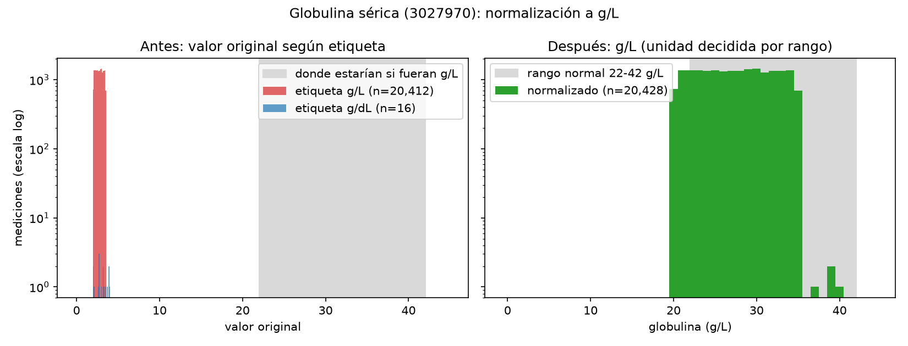

# Reporte de calidad — Lab 13 (Drug Exposure y Measurement)

Base: OMOP CDM del lab 12 (Synthea, 5,000 pacientes, ETL-Synthea), Postgres `omop_lab12`, esquema `cdm`. Consultas en `farmacoepi.sql`.

## 1. Tipo de exposición

| `drug_type_concept_id` | Tipo | Vocabulario del fármaco | Filas | Personas | % filas |
|---|---|---|---|---|---|
| 32838 | EHR prescription | RxNorm | 388,700 | 5,638 | 83.1 |
| 32827 | EHR encounter record | CVX (vacunas) | 78,890 | 5,896 | 16.9 |

Controles: 467,590 filas antes y después de los JOIN con `concept`; 0 filas con tipo NULL o 0.

**Diagnóstico:** los datos de medicamentos son **prescripciones** (la orden en la historia clínica). No hay dispensaciones ni administraciones de medicamentos; las vacunas registradas en la visita son lo más parecido a una administración. Por eso, «paciente expuesto» significa aquí «paciente al que se le recetó»: no sabemos si surtió la receta ni si tomó el fármaco, lo que **sobreestima la exposición real**, y cualquier adherencia (PDC, actividad 5) mide cobertura de recetas, no toma efectiva.

**Decisión derivada:** las métricas de fármacos (actividades 2-5) usan solo prescripciones; las vacunas se excluyen explícitamente (ver `DECISIONES.md`, decisión 2).

## 2. Caracterización de `drug_exposure` (solo prescripciones)

### 2a. Top 20 de ingredientes por pacientes distintos

Producto → ingrediente con `concept_ancestor` (decisión 3). Control del JOIN: 388,700 recetas → 448,889 pares receta-ingrediente (55 productos multi-ingrediente) → 388,700 recetas con ingrediente (ninguna se pierde).

| # | Ingrediente (concept_id) | Pacientes | Recetas |
|---|---|---|---|
| 1 | acetaminophen (1125315) | 3,675 | 21,958 |
| 2 | amoxicillin (1713332) | 1,659 | 1,992 |
| 3 | lisinopril (1308216) | 1,522 | 42,085 |
| 4 | ibuprofen (1177480) | 1,517 | 6,537 |
| 5 | naproxen (1115008) | 1,282 | 1,391 |
| 6 | simvastatin (1539403) | 1,270 | 6,772 |
| 7 | hydrochlorothiazide (974166) | 1,234 | 36,046 |
| 8 | clavulanate (1759842) | 1,231 | 1,378 |
| 9 | amlodipine (1332418) | 1,104 | 34,475 |
| 10 | nitroglycerin (1361711) | 1,077 | 1,135 |
| 11 | metoprolol (1307046) | 1,044 | 1,128 |
| 12 | ethinyl estradiol (1549786) | 1,026 | 2,207 |
| 13 | inert ingredients (19127890) | 906 | 1,787 |
| 14 | levonorgestrel (1589505) | 889 | 1,471 |
| 15 | clopidogrel (1322184) | 854 | 870 |
| 16 | penicillin V (1729720) | 755 | 822 |
| 17 | hydrocodone (1174888) | 710 | 7,283 |
| 18 | norethindrone (1521369) | 697 | 1,473 |
| 19 | dextromethorphan (1119510) | 680 | 723 |
| 20 | doxylamine (738818) | 680 | 723 |

Notas: «inert ingredients» no es un fármaco (son los placebos de los paquetes de anticonceptivos; artefacto de la jerarquía). Clavulanato, y dextrometorfano/doxilamina, aparecen por productos combinados: un producto suma un paciente a cada ingrediente. Las recetas por paciente separan crónicos (lisinopril 27.7) de agudos (amoxicilina 1.2).

### 2b. Distribución de `days_supply`

Sin NULL. Mínimo −6, p25 0, mediana 7, p75 56, p95 371, máximo 22,576 días. `days_supply` = fin − inicio en el 100 % de las filas: **lo derivó el ETL de las fechas**, no es un dato de farmacia independiente.

| Bandera | Recetas | % |
|---|---|---|
| Negativo (fin antes que inicio; imposible) | 479 | 0.1 |
| Cero (fin = inicio) | 137,360 | 35.3 |
| 1-365 días (plausible) | 205,860 | 53.0 |
| Exactamente 371 días | 41,980 | 10.8 |
| Más de 365 días (sin contar 371) | 3,021 | 0.8 |

La pila en 371 no parece un centinela: 68 productos, unas 3,900 recetas por año, encabezada por crónicos (lisinopril, hidroclorotiazida, amlodipino). Hipótesis: Synthea renueva la receta crónica en la visita anual y el ETL toma la siguiente visita como fecha de fin. Se pondrá a prueba en la actividad 4.

### 2c. Completitud de fechas y conceptos sin mapear

| Grupo | Filas | Sin fecha de fin | Fin = inicio | % sin fin o fin = inicio | Fin < inicio | `drug_concept_id = 0` |
|---|---|---|---|---|---|---|
| EHR prescription | 388,700 | 0 | 137,360 | 35.3 | 479 | 0 |
| EHR encounter record (vacunas) | 78,890 | 0 | 78,890 | 100.0 | 0 | 0 |
| Total | 467,590 | 0 | 216,250 | 46.2 | 479 | 0 |

Excluir las vacunas (decisión 2) baja el porcentaje de fin = inicio de 46.2 % a 35.3 %.

### Diagnóstico: ¿sirve esta base para estudiar exposición?

**Sirve para saber quién recibió una receta de qué ingrediente y cuándo empezó:** 0 % de conceptos sin mapear, 0 fechas nulas y una jerarquía completa. **Es débil para medir duración:** la duración no es un dato propio (es fin − inicio), un tercio de las recetas dura cero días, hay 479 duraciones imposibles y el 10.8 % comparte el mismo valor (371). Por eso, todo resultado que dependa de duración (eras, PDC) depende de las reglas de limpieza que se fijen en las actividades 4-5, y se reportará junto con ellas.

## 3. Búsqueda por ingrediente: lisinopril (1308216)

| Búsqueda | Pacientes |
|---|---|
| Directa (`drug_concept_id = 1308216`) | **0** |
| Con descendientes (`concept_ancestor`) | **1,522** |

**Por qué la diferencia es total:** las recetas nunca apuntan al ingrediente, sino a un producto concreto (*Clinical Drug*, 2 niveles por debajo: ingrediente → forma clínica → producto con dosis). La búsqueda directa no encuentra nada; sin `concept_ancestor` el lisinopril «no existiría» en esta base. Lo mismo ocurre con los otros seis candidatos medidos (acetaminofén, amoxicilina, simvastatina, hidroclorotiazida, amlodipino, metoprolol): búsqueda directa = 0 en todos.

| Producto en los datos | Pacientes | Recetas |
|---|---|---|
| lisinopril 10 MG Oral Tablet | 1,432 | 41,278 |
| lisinopril 20 MG Oral Tablet | 97 | 751 |
| lisinopril 5 MG Oral Tablet | 21 | 21 |
| lisinopril 40 MG Oral Tablet | 13 | 13 |
| hydrochlorothiazide 12.5 MG / lisinopril 20 MG Oral Tablet | 11 | 11 |
| lisinopril 2.5 MG Oral Tablet | 5 | 5 |
| hydrochlorothiazide 25 MG / lisinopril 20 MG Oral Tablet | 2 | 2 |
| lisinopril 30 MG Oral Tablet | 2 | 2 |
| hydrochlorothiazide 12.5 MG / lisinopril 10 MG Oral Tablet | 2 | 2 |

Los pacientes por producto suman 1,585, más que los 1,522 distintos: 63 pacientes aparecen con más de un producto (cambios de dosis o paso a combinación). Por eso el total se cuenta con `DISTINCT` sobre toda la jerarquía y no sumando productos. En el vocabulario, lisinopril tiene 98 descendientes (77 estándar; marcas, formas, grupos de dosis, combinaciones); en los datos solo aparecen 9.

**Corrección al diagnóstico de la actividad 2 (hallada en la actividad 4):** no todos los ceros de `days_supply` son recetas de un día. Synthea deja `STOP` vacío cuando la medicación sigue activa al exportar, y ETL-Synthea lo convierte en fin = inicio (`coalesce(m.stop, m.start)`; el NULL original queda en `verbatim_end_date`). De los 137,360 ceros de prescripciones, **17,654 (4.5 % de las prescripciones) son tratamientos en curso** y 119,706 son ceros que ya venían de Synthea.

## 4. `drug_era` construida a mano: lisinopril, gap de 30 días

**Origen de los datos.** Comparando el CSV crudo de Synthea con `cdm.drug_exposure`: el encadenamiento de recetas viene de **Synthea** (39,789 de 40,498 recetas consecutivas empiezan en el mismo segundo en que acaba la anterior; también vienen de ahí las duraciones de 7, 28 y 371 días y los 83 negativos). El fin = inicio de los tratamientos en curso viene del **ETL** (1,585 recetas de lisinopril). La lógica de `cdm.drug_era` es el script estándar OHDSI «non-stockpile» (`insert_drug_era.sql` de ETL-Synthea v2.1.1).

**Reglas** (decisión 6, iguales a las de la referencia): fin = `end_date`, negativos excluidos (42,085 → 42,002 exposiciones), solapes fusionados sin desplazar, una era nueva cuando una exposición empieza más de 30 días después del **fin máximo acumulado** de las anteriores.

| Fuente | Eras | Pacientes | Exposiciones | `gap_days` total |
|---|---|---|---|---|
| Propia (`results.lisinopril_era`) | 1,541 | 1,522 | 42,002 | 0 |
| `cdm.drug_era` | 1,541 | 1,522 | 42,002 | 0 |

**Comparación era por era** (`FULL OUTER JOIN` por paciente y fecha de inicio): 1,541 filas tras el JOIN, **1,541 idénticas** en inicio, fin, número de exposiciones y `gap_days`; 0 solo en una tabla, 0 con otro fin. No hay diferencias que explicar.

**Lectura.** 1,503 pacientes tienen una sola era y 19 tienen dos (interrumpieron más de 30 días). Duración mediana de la era 9.9 años (p25 7.0, p75 10.2, máximo 11.0): el tratamiento crónico de Synthea es un continuo casi perfecto, sin huecos (`gap_days` = 0 en todas). **116 eras duran 0 días** y las 116 vienen de tratamientos en curso que el ETL convirtió en fin = inicio: no son pacientes con una sola toma, sino pacientes activos cuya última receta perdió su duración.

**Error evitado.** Calcular el hueco contra la receta inmediatamente anterior (`LAG`) en lugar del fin máximo acumulado da 6 huecos de 1-30 días y 31 rupturas → 1,553 eras (12 de más). Son falsos: una receta larga anterior (típicamente de 371 días) seguía cubriendo al paciente. El resultado erróneo es plausible y no da error; se detecta solo al comparar con la referencia.

## 5. Adherencia: PDC a un año (lisinopril)

**Diseño (decisión 7):** índice = primera receta de lisinopril (usuario nuevo); ventana de 365 días [índice, índice + 364]; se exige `observation_period` hasta el fin de la ventana (1,522 → **1,461 pacientes**; 61 excluidos por seguimiento corto); cada día cuenta una vez (sin *stockpiling*); recetas «en curso» extendidas hasta el fin de observación (principal) o con 0 días como dejó el ETL (sensibilidad). Controles: 365 días por paciente en todos, PDC ∈ [0, 1], principal ≥ sensibilidad en todos.

| Medida | Media | Mediana | = 0 | 0-0.5 | 0.5-0.8 | ≥ 0.8 | % adherentes (≥ 0.8) | > 1 |
|---|---|---|---|---|---|---|---|---|
| **PDC principal** (en curso extendido) | 1.000 | 1.000 | 0 | 0 | 0 | 1,461 | **100.0 %** | 0 |
| PDC sensibilidad (reglas del ETL) | 0.954 | 1.000 | 65 | 2 | 2 | 1,392 | 95.3 % | 0 |
| MPR (contraste) | 1.060 | 1.016 | 65 | 2 | 2 | 1,392 | 95.3 % | **1,390** |

**Supuestos que hubo que hacer:**
1. Las prescripciones equivalen a fármaco disponible (no hay dispensaciones): el PDC mide **cobertura de recetas**, no surtido ni toma (sección 1).
2. Una receta sin fecha de fin en Synthea (en curso al exportar) cubre hasta el fin de la observación. Este único supuesto mueve el porcentaje de adherentes de 95.3 % a 100 % y elimina 65 PDC = 0 que eran pacientes en tratamiento.

**PDC vs MPR — se usó PDC.** El MPR suma los `days_supply` de las recetas del periodo y divide por los días del periodo: los solapes cuentan dos veces y una receta que se sale de la ventana cuenta entera, así que puede superar 1 y sobreestima la adherencia. Aquí 1,390 de 1,461 pacientes tienen MPR > 1 (típicamente 1.016 = 371/365, una sola receta de 371 días; máximo 2.014). El PDC cuenta días distintos cubiertos, está acotado en [0, 1] y es la medida que usa la Pharmacy Quality Alliance en sus indicadores de adherencia, con umbral 0.8 para la mayoría de las clases (incluidos los antagonistas del sistema renina-angiotensina, grupo del lisinopril). La revisión de Andrade et al. documenta que el MPR y medidas afines eran las más usadas en bases automatizadas, y que las definiciones varían mucho entre estudios.

**Lectura: el resultado no es un hallazgo clínico.** Un PDC de 1.0 en el 100 % de los pacientes es un artefacto del encadenamiento de recetas de Synthea (actividad 4). En datos reales, un metaanálisis de 26 estudios encontró que solo el **48.5 %** (IC 95 % 47.7-49.2 %) de los pacientes era adherente a antihipertensivos al año, con un rango de 20 % a 88 % entre estudios, y 62.2 % en los estudios que usaron PDC (Lemstra y Alsabbagh, 2014). Esta base sirve para **practicar el cálculo** del PDC, no para estimar adherencia.

**Fuentes:**
- Lemstra M, Alsabbagh MW. *Proportion and risk indicators of nonadherence to antihypertensive therapy: a meta-analysis.* Patient Prefer Adherence. 2014;8:211-218. doi:10.2147/PPA.S55382
- Andrade SE, Kahler KH, Frech F, Chan KA. *Methods for evaluation of medication adherence and persistence using automated databases.* Pharmacoepidemiol Drug Saf. 2006;15(8):565-574. doi:10.1002/pds.1230
- Pharmacy Quality Alliance. *PQA Measures Overview* (medidas de adherencia basadas en PDC). https://www.pqa.org/assets/Measures/PQA_Measures_Overview.pdf (consultado el 2026-11-10)

## 6. Caracterización de `measurement`

### 6a. Top 15 de analitos
Los primeros puestos por número de mediciones no coinciden con los primeros por pacientes: *Pain severity* tiene 204,571 mediciones en 5,904 pacientes, mientras que *Weight difference [Mass] --pre and post dialysis* acumula 104,415 mediciones en solo **340 pacientes** (mediciones repetidas en cada sesión de diálisis). El panel metabólico aporta 69,106 mediciones en 2,748 pacientes. Para seleccionar una cohorte importa contar pacientes, no filas.

### 6b. Unidades de la globulina (3027970)

| Unidad | `unit_source_value` | Mediciones | Pacientes | Mín | p05 | Mediana | p95 | Máx |
|---|---|---|---|---|---|---|---|---|
| g/L (8636) | g/L | 20,412 | 998 | 2.0 | 2.1 | 2.8 | 3.4 | 3.5 |
| g/dL (8713) | g/dL | 16 | 16 | 2.0 | 2.0 | 3.1 | 3.9 | 4.0 |

**Hallazgo: unidad mal etiquetada en origen.** La globulina sérica normal está en torno a 2.0-3.5 g/dL, es decir, 20-35 g/L. Las dos unidades tienen valores en la misma escala (2-4), así que las 20,412 filas «en g/L» son en realidad g/dL: una mediana de 2.8 g/L equivaldría a 0.28 g/dL, un valor incompatible con la vida.
- **Origen:** Synthea, no el ETL. `unit_source_value` ya dice «g/L» y el ETL lo mapeó fielmente al concepto 8636.
- **Tipo (marco de Kahn, usado por OHDSI DQD):** falla de **plausibilidad**. El valor es imposible para la unidad declarada.
- **Consecuencia:** una normalización que se fíe de la etiqueta multiplicaría por 10 solo las 16 filas en g/dL y mezclaría dos escalas que hoy son coherentes. La unidad real se decide **por el rango del valor**. Esa regla es válida aquí porque los rangos de g/dL (2-4) y g/L (20-40) no se solapan, y no sirve como método general (actividad 7).
- No se corrige `cdm.measurement`. La corrección va a una tabla derivada que conserva el valor y la unidad originales.

### 6c. Valores nulos y operador

| Mediciones | Sin `value_as_number` | % | Con valor en texto | Sin ningún valor |
|---|---|---|---|---|
| 4,008,280 | 913,931 | 22.8 % | 667,333 | 246,598 |

El 22.8 % **no son datos faltantes**, son dos casos distintos:
- **667,333 resultados cualitativos** con el valor solo como texto en `value_source_value`: tiras de orina («Urine ketone test = +»), color y aspecto de la orina. En OMOP deberían ir en `value_as_concept_id`, que el ETL de Synthea no llena.
- **246,598 registros sin ningún valor:** cribados y cuestionarios cuyo concepto es de clase *Procedure* o *Staging / Scales* (cribado de depresión 61,950; PHQ-2 55,677; consumo de sustancias 21,331; violencia doméstica 21,324). Registran que el cribado se hizo, no su resultado.

**`operator_concept_id`: 100 % lleno y 0 % informativo.** Las 4,008,280 filas tienen operador 0 («sin concepto»), y ningún `value_source_value` empieza por `<` o `>`. Medir la completitud con `IS NOT NULL` daría 100 %. La medida correcta es `coalesce(operator_concept_id, 0) <> 0`, que da **0 %**. La misma regla aplica a cualquier columna `*_concept_id` (ejemplo: GFR con `unit_concept_id = 0` en 59,485 filas).

**Valores censurados.** En esta base no hay ninguno, pero en datos reales aparecen (p. ej., «<0.01 ng/mL»). Se pueden sustituir por el límite de detección o por LD/2 (simple, con sesgo) o tratar con modelos para datos censurados (Tobit, supervivencia). En todos los casos hay que **conservar el operador**: sin él, «<0.01» queda como 0.01 y pasa por un valor medido.

## 7. Normalización de unidades: globulina a g/L

**Regla.** Unidad canónica **g/L** (SI). La unidad real de cada fila se decide **por el rango del valor**, no por la etiqueta (sección 6b): valor < 10 → g/dL → ×10; valor ≥ 10 → g/L → ×1. El umbral funciona porque las dos escalas no se solapan: la globulina normal es ~2.2-4.2 g/dL = 22-42 g/L. No es un método general y hay que revisarlo para cada analito.

**Factor y fuentes:**
- 1 g/dL = **10 g/L**. UCUM define el prefijo d = 10⁻¹ (tabla 1) y L = dm³ (tabla 5), de modo que 1 dL = 0.1 L. *The Unified Code for Units of Measure*, https://ucum.org/ucum (consultado el 2026-11-11).
- Rango normal: suma de los mínimos y máximos de las fracciones alfa-1 (0.2-0.4), alfa-2 (0.6-0.9), beta (0.6-1.1) y gamma (0.8-1.8 g/dL) = 2.2-4.2 g/dL. La suma es nuestra; la fuente no da la globulina total. La misma página da cada fracción en g/dL y g/L, lo que confirma el factor ×10. MedlinePlus, *Protein electrophoresis – serum*, https://medlineplus.gov/ency/article/003540.htm (revisión 29/01/2026).

**Resultado** (`results.globulina_normalizada`; conserva `valor_original`, `unidad_original_concept_id`, `unidad_original_texto` y la columna `regla_aplicada`):

| Regla aplicada | Unidad original | Unidad inferida | Filas | Original | En g/L |
|---|---|---|---|---|---|
| reetiquetada_por_rango | g/L | g/dL | 20,412 | 2.0-3.5 | 20-35 |
| etiqueta_coherente | g/dL | g/dL | 16 | 2.0-4.0 | 20-40 |

**Filas convertidas: 20,428** (100 % del analito, 0 nulos). De ellas, **20,412 se reetiquetaron**. La regla se aplica fila a fila: un valor ≥ 10 bien etiquetado en g/L no se tocaría.

*`figura_globulina.py`. Eje Y logarítmico y bins con la resolución de los datos (0.1 antes, 1 después).*

**Lectura de la figura.**
- **Antes:** las dos etiquetas caen en 2-4, lejos de la banda donde estarían valores reales en g/L.
- **Después:** una sola escala, 20-40 g/L.
- La distribución es **plana** (~1,350 mediciones por cada valor entero de 21 a 34), no una campana. Parece que Synthea genera el valor de forma uniforme en un rango fijo, así que los datos sirven para practicar la normalización, no para describir la globulina de una población.
- ~700 filas en 20 g/L quedan por debajo de 22. Se revisan en la sección 8: los rangos de referencia varían entre laboratorios.

## Anexo. Checklist para reutilizar Synthea

Problemas encontrados en este lab que conviene revisar cada vez que se genere una población nueva. Los laboratorios de Synthea salen de módulos JSON escritos a mano (código, unidad y regla para generar el valor), así que un error en un módulo **se repite igual en todos los pacientes**.

- [ ] **Plausibilidad por analito y unidad** (consulta tipo 6b o DQD). Caso real: globulina con 20,412 valores entre 2.0 y 3.5 etiquetados como g/L, que en realidad son g/dL. Es un error de origen: `unit_source_value` ya dice «g/L».
- [ ] **Fechas de fin de las recetas.** En el CSV de Synthea el fin de una receta coincide con el inicio de la siguiente (recetas encadenadas). Además, el ETL convierte `stop` NULL en 0 días: 17,654 recetas en curso quedan con duración cero (secciones 4 y 5).
- [ ] **Acumulación en `days_supply` ≈ 371 días** (41,980 filas): es la renovación anual de los tratamientos crónicos, no un dato clínico (sección 2).
- [ ] **Unidades sin mapear:** el GFR tiene `unit_concept_id = 0` aunque `unit_source_value` trae la unidad.
- [ ] **Campos que nunca se llenan:** `operator`, `value_as_concept_id` y `range_low`/`range_high`. Algunos valores solo aparecen en `value_source_value` (p. ej., tabaquismo, LOINC 72166-2, en `observation`).
- [ ] **Datos «demasiado limpios»:** casi una sola unidad por analito y ningún valor censurado (`<`, `>`). Un pipeline que funciona con Synthea no queda validado para datos reales.

**Qué hacer cuando aparece un error de origen:** no corregir las tablas del CDM. Se corrige en una tabla derivada (`results`) conservando el valor y la unidad originales, se documenta la regla y, si procede, se reporta al proyecto (issue en Synthea) o se edita el módulo y se regenera la población dejando constancia de la versión modificada.
