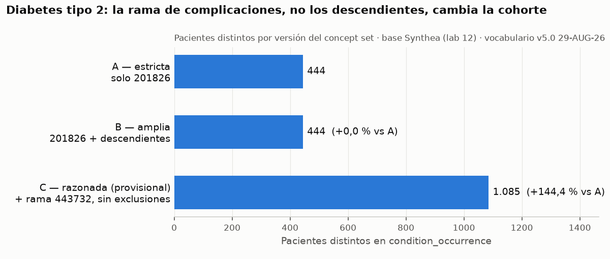

# Justificación del concept set — Diabetes mellitus tipo 2

## 1. Condición y pregunta de investigación

**Condición:** diabetes mellitus tipo 2 (T2DM) en adultos: hiperglucemia crónica por resistencia a la insulina con déficit relativo de su secreción. No incluye la diabetes tipo 1, la gestacional ni la secundaria a otras enfermedades.

**Por qué importa y qué pregunta responde:** la T2DM es una de las enfermedades crónicas con más tratamientos farmacológicos y más estudios con datos de vida real en la industria farmacéutica. Usaría la cohorte para describir **cómo se usa la metformina** (primera línea de tratamiento) en pacientes con T2DM: cuántos la inician, cuándo y cuánto tiempo la mantienen. Para esta pregunta importa sobre todo que los pacientes de la cohorte tengan T2DM de verdad (valor predictivo positivo).

**Pacientes en la base:** 444 pacientes distintos con el concepto `201826` (444 filas: Synthea registra la condición crónica una sola vez), muy por encima del mínimo de ~50. No hizo falta cambiar de condición.

## 2. Concepto semilla

Transcripción de la tabla `concept` (vocabulario OHDSI v5.0 29-AUG-26, el mismo que publica ATHENA):

| concept_id | concept_name | domain_id | vocabulary_id | concept_class_id | standard_concept | invalid_reason | vigencia |
|---|---|---|---|---|---|---|---|
| 201826 | Type 2 diabetes mellitus | Condition | SNOMED | Disorder | S | (vacío) | 2002-01-31 a 2099-12-31 |

Es estándar, su dominio es Condition (sus pacientes están en `condition_occurrence`) y está vigente. Código SNOMED CT: 44054006.

- **Padre inmediato:** `201820` Diabetes mellitus (un solo padre).
- **Descendientes:** 14 (12 hijos directos y 2 nietos). Ninguno aparece en los datos de la base.

**Conceptos descartados en la búsqueda:** `1567956` (ICD10CM E11) y `35206882` (ICD10CM E11.9) no son estándar; `506756` Maternal history of T2DM es de dominio Observation y está reemplazado (`U`).

**Rama hermana de complicaciones:** las complicaciones («Microalbuminuria due to type 2 diabetes mellitus», retinopatía, neuropatía…) no son descendientes de `201826`, sino de su hermano `443732` «Disorder due to type 2 diabetes mellitus» (estándar, Condition, vigente, 118 descendientes). Hay 641 pacientes con alguna complicación y sin el código `201826`. La semilla sigue siendo `201826`; la rama `443732` entra en la versión C como inclusión razonada (ver sección de decisiones).

## 3. Traducción de ICD-10-CM a conceptos estándar

16 códigos de ICD-10-CM FY2027 (CDC/CMS), traducidos con `'Maps to'` y los cuatro filtros: dirección fuente → estándar, destino estándar, destino vigente y relación vigente. En esta base las 1,254,595 relaciones `'Maps to'` están vigentes, así que el cuarto filtro no quita ninguna; se aplica igual para que la consulta sirva con cualquier vocabulario.

| codigo_icd10 | concept_id_origen | concept_id_estandar | nombre_estandar | dónde cae |
|---|---|---|---|---|
| E11.9 | 35206882 | 201826 | Type 2 diabetes mellitus | semilla |
| E11.65 | 45605405 | 201826 · 37016349 | T2DM · Hyperglycemia due to T2DM | semilla · rama |
| E11.21 | 45591027 | 201826 · 443731 | T2DM · Renal disorder due to T2DM | semilla · rama |
| E11.22 | 45595797 | 201826 · 43531578 | T2DM · Chronic kidney disease due to T2DM | semilla · rama |
| E11.319 | 45581353 | 201826 · 443733 | T2DM · Disorder of eye due to T2DM | semilla · rama |
| E11.42 | 45557113 | 201826 · 37017432 | T2DM · Polyneuropathy due to T2DM | semilla · rama |
| E11.51 | 45533021 | 201826 · 443729 | T2DM · Peripheral circulatory disorder due to T2DM | semilla · rama |
| E11.621 | 45581355 | 201826 · 43530690 | T2DM · Foot ulcer due to T2DM | semilla · rama |
| E11.649 | 45591031 | 201826 · 45757363 | T2DM · Hypoglycemia due to T2DM | semilla · rama |
| E11.8 | 35206881 | 201826 · 442793 | T2DM · Complication due to diabetes mellitus | semilla · fuera |
| E11.A | 1348414 | 45766052 | Type 2 diabetes mellitus in remission | semilla |
| E11.640 | 35206880 | — | (código retirado, sin mapeo) | — |
| O24.111 | 45587292 | 43531010 · 4239938 | Pre-existing T2DM in pregnancy · First trimester pregnancy | semilla · fuera |
| E13.9 | 35206885 | 201820 | Diabetes mellitus | fuera |
| R73.03 | 37201113 | 37018196 | Prediabetes | fuera |
| Z79.84 | 37202300 | 46272450 | Long-term current use of drug therapy (Observation) | fuera |

**Conteo:** de los 16 códigos, **10 mapean a más de un concepto estándar** y **1 no mapea a ninguno** (E11.640, retirado; su sustituto es E11.649). Los 16 códigos dan 25 destinos, que son 16 conceptos estándar distintos: 3 bajo la semilla, 8 en la rama de complicaciones y 5 fuera. En la categoría E11 completa, 113 de 118 códigos son 1:N y generan 233 filas: un JOIN que asumiera 1:1 casi duplicaría cualquier conteo por filas.

**Qué dice el contraste:**
- Todas las complicaciones caen en la rama `443732`, ninguna bajo la semilla: la decisión de incluir esa rama en la versión C tiene respaldo en cómo se codifica en la práctica.
- Dos destinos «bajo la semilla» son candidatos a exclusión en la actividad 6: `43531010` (embarazo) y `45766052` (en remisión). Ojo: E11.A mapea solo a «in remission», no a T2DM.
- Los 5 destinos «fuera» no son T2DM y no deben entrar: «Diabetes mellitus» y «Complication due to diabetes mellitus» son más generales (incluyen la tipo 1), «First trimester pregnancy» describe el embarazo, «Prediabetes» es otra entidad y «Long-term current use of drug therapy» es una observación sobre el tratamiento.

## 4. Tres versiones del concept set

Las tres versiones salen de la vista `results.cs_t2dm` (ver `concept_set.sql`, actividad 4a), calculada desde `concept_ancestor`. No hay listas pegadas a mano.

| Versión | Definición | Conceptos |
|---|---|---|
| **A — estricta** | solo la semilla `201826` | 1 |
| **B — amplia** | semilla + todos sus descendientes | 15 |
| **C — razonada** | semilla + rama `443732` «Disorder due to type 2 diabetes mellitus», cada una con sus descendientes, menos las exclusiones de la actividad 6 (cada exclusión con sus descendientes) | 131 (134 antes de las 3 exclusiones de la actividad 6) |

Los 134 conceptos de partida son estándar, de dominio Condition y están vigentes, y las dos ramas no comparten ninguno. La revisión de la actividad 6 quitó 3 (embarazo ×2 y remisión), cada uno con sus descendientes: C queda en 131.

## 5. Impacto en pacientes distintos

| Versión | Conceptos | Filas en `condition_occurrence` | Pacientes distintos | Diferencia vs A | Prevalencia bruta (/ 5,904) |
|---|---|---|---|---|---|
| A — estricta | 1 | 444 | **444** | — | 7.5 % |
| B — amplia | 15 | 444 | **444** | +0 (+0.0 %) | 7.5 % |
| C — razonada | 131 | 2,163 | **1,085** | +641 (+144.4 %) | 18.4 % |

C frente a B: +641 pacientes (+144.4 %). Se cuentan pacientes distintos: en C hay 2,163 filas para 1,085 pacientes, porque un paciente puede tener T2DM y una o varias complicaciones registradas.

`figura_impacto.png` se genera con `figura_impacto.py` a partir de la vista `results.cs_t2dm`.

**Qué prevalencia reportaría.** Reportaría la de la **versión C** como estimación principal, y A y B como análisis de sensibilidad. A y B solo cuentan a quien tiene registrado el código de T2DM, y dejan fuera a 641 pacientes cuyo diagnóstico consta únicamente como una complicación «due to type 2 diabetes mellitus», algo que no puede existir sin T2DM. Reportar A subestimaría la prevalencia en más de la mitad, por una particularidad de la jerarquía de SNOMED y no por un criterio clínico. Que B no añada pacientes respecto de A muestra que, en esta base, «incluir descendientes» no es la decisión que más pesa: lo que más pesa es reconocer la rama hermana. Mostrar las tres cifras deja ver al lector cuánto depende el resultado de la definición. Dos limitaciones: el denominador incluye a todas las personas de la base (también niños y personas con poco seguimiento), y los datos son sintéticos (Synthea), así que el 18.4 % valida el método pero no estima la prevalencia real.

## 6. Revisión manual de descendientes

La versión B tiene 14 descendientes (menos de 20), así que se revisaron todos. Como la versión C incluye además la rama `443732`, se revisó también una muestra de 20 de sus 118 descendientes, reproducible con `ORDER BY md5(concept_id::text || 'lab14') LIMIT 20` (la sal `'lab14'` hace de semilla fija; mismo resultado en cualquier máquina). Pregunta de cada veredicto: ¿este concepto identifica a un paciente con T2DM activa, candidato a usar metformina por esa causa?

**Descendientes de B (14, todos):**

| concept_id | nombre | pacientes | ¿pertenece? |
|---|---|---|---|
| 40483315 | Brittle type 2 diabetes mellitus | 0 | sí |
| 45757474 | Diabetes mellitus type 2 without retinopathy | 0 | sí |
| 4130162 | Insulin treated type 2 diabetes mellitus | 0 | sí |
| 37163431 | Ketosis-resistant diabetes mellitus | 0 | sí |
| 4063043 | Pre-existing type 2 diabetes mellitus | 0 | sí |
| 43531010 | Pre-existing type 2 diabetes mellitus in pregnancy | 0 | **no** |
| 4129519 | Pregnancy and type 2 diabetes mellitus | 0 | **no** |
| 45757508 | Type 2 diabetes mellitus controlled by diet | 0 | sí |
| 4230254 | Type 2 diabetes mellitus in nonobese | 0 | sí |
| 4304377 | Type 2 diabetes mellitus in obese | 0 | sí |
| 45766052 | Type 2 diabetes mellitus in remission | 0 | **no** |
| 4099651 | Type 2 diabetes mellitus with ulcer | 0 | sí |
| 40482801 | Uncontrolled type 2 diabetes mellitus | 0 | sí |
| 40485020 | Well controlled type 2 diabetes mellitus | 0 | sí |

**Muestra de la rama 443732 (20 de 118):**

| concept_id | nombre | pacientes | ¿pertenece? |
|---|---|---|---|
| 37016768 | Autonomic neuropathy due to type 2 diabetes mellitus | 0 | sí |
| 609114 | Bilateral nonproliferative retinopathy due to diabetes mellitus type 2 | 0 | sí |
| 609117 | Bilateral proliferative retinopathy due to diabetes mellitus type 2 | 0 | sí |
| 1075909 | Chronic kidney disease stage 3A due to type 2 diabetes mellitus | 0 | sí |
| 376065 | Disorder of nervous system due to type 2 diabetes mellitus | 0 | sí |
| 4223463 | Exudative maculopathy due to type 2 diabetes mellitus | 0 | sí |
| 43530690 | Foot ulcer due to type 2 diabetes mellitus | 0 | sí |
| 45757445 | Hypertension in chronic kidney disease stage 4 due to type 2 diabetes mellitus | 0 | sí |
| 45770830 | Macular edema and retinopathy due to type 2 diabetes mellitus | 22 | sí |
| 609101 | Mild nonproliferative retinopathy of right eye due to diabetes mellitus type 2 | 0 | sí |
| 43531651 | Mixed hyperlipidemia due to type 2 diabetes mellitus | 0 | sí |
| 609105 | Moderate nonproliferative retinopathy of right eye due to diabetes mellitus type 2 | 0 | sí |
| 43531563 | Neuropathic arthropathy due to type 2 diabetes mellitus | 0 | sí |
| 37312203 | Neuropathic ulcer of heel due to type 2 diabetes mellitus | 0 | sí |
| 45770883 | Neuropathic ulcer of toe due to type 2 diabetes mellitus | 0 | sí |
| 43530685 | Proliferative retinopathy due to type 2 diabetes mellitus | 15 | sí |
| 609116 | Proliferative retinopathy of left eye due to diabetes mellitus type 2 | 0 | sí |
| 443731 | Renal disorder due to type 2 diabetes mellitus | 0 | sí |
| 45773064 | Traction detachment of retina due to type 2 diabetes mellitus | 0 | sí |
| 36712686 | Ulcer of left foot due to type 2 diabetes mellitus | 0 | sí |

**Falsos positivos:** 3 de 14 en B (dos de embarazo y uno de remisión) y 0 de 20 en la muestra de la rama. La muestra limpia respalda que la rama es homogénea: todos sus conceptos son «X due to type 2 diabetes» y presuponen la enfermedad. Por eso no se revisaron los 118 completos; se habría hecho si la muestra hubiera encontrado algún falso positivo.

**Exclusiones que pasan a la versión C** (cada una con sus descendientes): `43531010`, `4129519` y `45766052`. C pasa de 134 a 131 conceptos. Ningún paciente de esta base tiene esos conceptos, así que la cohorte sigue en 1,085; la definición cambia aunque esta base no lo refleje.

## 7. Decisiones del concept set final (versión C)

Una fila por cada concepto excluido y por cada inclusión que no es obvia. Las razones se dan en términos de la pregunta de investigación: describir el uso de la metformina en pacientes con T2DM.

| concept_id | nombre | incluido | por qué |
|---|---|---|---|
| 43531010 | Pre-existing type 2 diabetes mellitus in pregnancy | **no** | Durante el embarazo el tratamiento de elección es la insulina: la paciente suspende la metformina por motivos obstétricos, y eso se leería como falta de persistencia. Es una población con manejo y seguimiento distintos. |
| 4129519 | Pregnancy and type 2 diabetes mellitus | **no** | Mismo motivo: describe la diabetes en el contexto del embarazo. Se excluye con sus descendientes. |
| 45766052 | Type 2 diabetes mellitus in remission | **no** | Sin enfermedad activa no hay indicación de tratamiento: estos pacientes no son candidatos a metformina y bajarían artificialmente su uso. El código ICD-10-CM E11.A mapea solo a este concepto. |
| 443732 (+118 descendientes) | Disorder due to type 2 diabetes mellitus | **sí** | Las complicaciones «due to type 2 diabetes» (nefropatía, retinopatía, neuropatía, pie diabético…) presuponen la enfermedad. En SNOMED no cuelgan de 201826, sino de este concepto hermano; sin él se perderían pacientes cuyo diagnóstico solo consta como complicación. Ver la advertencia del párrafo final sobre esta base. |
| 4130162 | Insulin treated type 2 diabetes mellitus | **sí** | Es T2DM; muchos pacientes con insulina siguen tomando metformina. Excluirlos dejaría una cohorte de casos leves. |
| 4063043 | Pre-existing type 2 diabetes mellitus | **sí** | Aunque el término se use en contexto obstétrico, afirma que el paciente tiene T2DM. Lo que describe el embarazo es su hijo `43531010`, que sí se excluye. |
| 45757508 | Type 2 diabetes mellitus controlled by diet | **sí** | Son pacientes con T2DM sin fármacos: justo los candidatos a iniciar metformina, y el inicio es parte de la pregunta. |

**Conceptos considerados que no se añadieron** (aparecieron como destinos de códigos ICD-10-CM en la actividad 3):

| concept_id | nombre | incluido | por qué |
|---|---|---|---|
| 201820 | Diabetes mellitus | no | Es el padre de la semilla: incluye la diabetes tipo 1, la gestacional y la secundaria, que tienen otra fisiopatología y otro tratamiento. |
| 442793 | Complication due to diabetes mellitus | no | No especifica el tipo de diabetes. |
| 4239938 | First trimester pregnancy | no | Describe un embarazo, no una diabetes: metería a cualquier embarazada. |
| 37018196 | Prediabetes | no | Es otra entidad, sin diagnóstico de diabetes. |
| 46272450 | Long-term current use of drug therapy | no | Observación sobre un tratamiento, de dominio Observation; no identifica la enfermedad. |

### Sensibilidad y valor predictivo positivo

La **sensibilidad** es la fracción de pacientes con T2DM que la definición captura; el **valor predictivo positivo (VPP)** es la fracción de pacientes capturados que de verdad tienen T2DM. Para la pregunta de este trabajo, el uso de metformina, el error que más daña es el **falso positivo**: un paciente sin T2DM en la cohorte nunca recibirá metformina por esa causa y hace parecer más bajo el uso del fármaco. Un falso negativo solo reduce el tamaño de la cohorte, y la descripción de los pacientes incluidos sigue siendo válida, siempre que los casos perdidos no se diferencien en su tratamiento.

Sobre el papel, la versión C está pensada para **subir la sensibilidad sin perder VPP**: añade la rama de complicaciones, que en una base real presupone T2DM, y excluye solo las formas en las que el tratamiento cambia por razones ajenas a la conducta que se quiere medir (embarazo) o en las que no hay enfermedad activa (remisión). Sus pérdidas de sensibilidad son deliberadas (embarazadas con T2DM) o están fuera del alcance de un concept set de diagnósticos: pacientes con T2DM documentada solo por el laboratorio (HbA1c) o por el fármaco, o con códigos fuente retirados que no mapean (como E11.640).

En esta base, sin embargo, la definición **tiende a meter casos que no son**. Los 641 pacientes que entran solo por la rama de complicaciones no se comportan como diabéticos tipo 2: ninguno toma metformina (los 231 usuarios están todos en la versión A), 402 tienen además el código de prediabetes, 402 usan insulina y solo 1 de 441 con dato tiene alguna HbA1c ≥ 6.5 % (actividad 7a, en `concept_set.sql`). Parece un artefacto de cómo Synthea genera las complicaciones, no un fallo del vocabulario. Su efecto en la pregunta es grande: el porcentaje de pacientes con metformina pasaría del 52 % (231/444) con la versión A al 21 % (231/1,085) con la C. El concept set se mantiene, porque es correcto para una base real. Para la cohorte de la sesión 17 propongo no fiarse de un solo código y exigir además una segunda evidencia, que es como se construyen los fenotipos validados de OHDSI. Esa evidencia tiene dos límites (actividad 7b). Primero, no puede ser la metformina: para una pregunta sobre su uso sería circular, porque la cohorte se elegiría por el mismo resultado que se quiere medir. Segundo, contar la insulina no sirve de filtro, porque 402 de los 641 pacientes dudosos la usan. La HbA1c ≥ 6.5 % sí filtra la rama (de 641 a 1), pero a costa de sensibilidad: el grupo A baja de 444 a 252, en parte porque Synthea genera valores de HbA1c imposibles. Es el equilibrio entre sensibilidad y VPP en estado puro: el VPP sube y la sensibilidad baja. Qué evidencia exacta usar se decidirá en la sesión 17. Con datos reales, el VPP se mediría revisando una muestra de historias clínicas o con PheValuator; en Synthea no hay historia que revisar, así que esta evidencia indirecta es lo único disponible.

## 8. Comparación con la OHDSI Phenotype Library (bono)

Definición de referencia: cohorte **957 «[P] Type 2 diabetes mellitus»** de la [OHDSI Phenotype Library](https://github.com/OHDSI/PhenotypeLibrary) (`inst/cohorts/957.json`, estado «Pending», 2023-09-20). La entrada es un código de T2DM seguido de otro código de T2DM, de al menos 2 antidiabéticos no insulínicos o de al menos 2 HbA1c > 6.5 %. Su concept set de diagnósticos se transcribió en `concept_set.sql` (bono a) y se expandió con el mismo vocabulario que la versión C. En la librería hay otras dos definiciones de T2DM: la **503** es igual a nuestra versión B (201826 con descendientes) y la **288** parte de «Diabetes mellitus» y resta la tipo 1, la secundaria y la del embarazo.

| | Versión C | OHDSI 957 |
|---|---|---|
| Conceptos | 131 | 265 |
| Pacientes distintos | 1,085 | 1,196 |

**Qué incluimos los dos:** los 131 conceptos de C, incluida la rama `443732` «Disorder due to type 2 diabetes mellitus». La definición de la comunidad respalda la decisión de añadir las complicaciones que SNOMED no cuelga de la semilla.

**Qué incluyeron ellos y nosotros no (134 conceptos):**
- Nuestras 3 exclusiones (`43531010`, `4129519`, `45766052`): OHDSI no excluye el embarazo ni la remisión en el concept set.
- 131 complicaciones «due to diabetes mellitus» sin tipo: 102 oculares (`443767`), 22 renales (`192279`) y 7 comas (`443735`), de las que restan las formas explícitas de tipo 1. En esta base solo una tiene pacientes, «Disorder of kidney due to diabetes mellitus» (929), y añade 111 pacientes que C no tiene.

**Qué excluyeron ellos:** la diabetes tipo 1 y sus complicaciones, y el coma hiperosmolar de la diabetes secundaria. Nuestra C no los necesita excluir, porque parte de conceptos que ya dicen «type 2».

**Por qué difieren.** Son dos maneras de repartir el trabajo entre sensibilidad y VPP. OHDSI hace el concept set **amplio** (acepta complicaciones sin tipo, embarazo y remisión) y recupera el VPP en la **cohorte**, exigiendo una segunda evidencia. Nuestra C hace el filtro en el propio **concept set**: solo conceptos que afirman T2DM y sin formas que cambian el tratamiento. Coincidimos en un punto que llegamos a ver por separado: la segunda evidencia de OHDSI usa antidiabéticos **excluyendo la insulina**, lo mismo que mostró la actividad 7b (con insulina, 402 de los 641 pacientes dudosos pasarían el filtro). Mantengo la versión C sin cambios. Para la sesión 17 queda decidir si se adopta la lógica de segunda evidencia de OHDSI; para la pregunta de la metformina, esa evidencia no puede basarse en la metformina.
