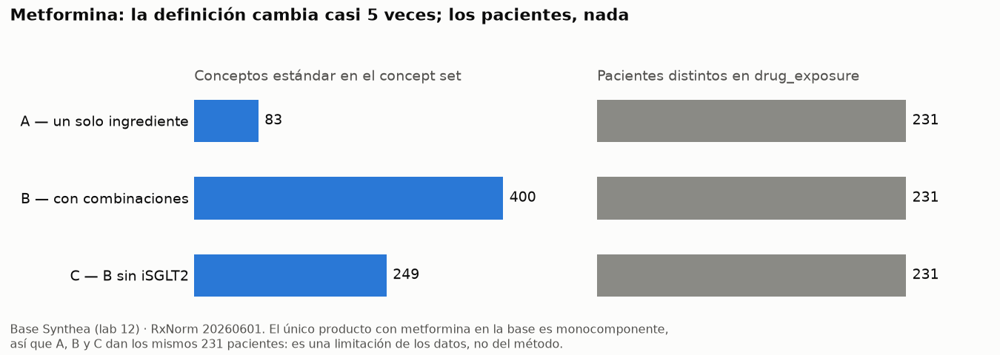

# Actividad 4 — «Exposición a metformina», tres veces

Consulta: `actividades.sql`, actividad 4a. Figura: `figura_metformina.png` (generada con `figura_metformina.py`). Semilla: ingrediente RxNorm metformin (`concept_id` 1503297, RxCUI 6809). Solo conceptos estándar (`standard_concept = 'S'`).

| Versión | Qué incluye | Cómo se genera | Conceptos | Pacientes distintos |
|---|---|---|---|---|
| **A** | Productos de un solo ingrediente | Descendientes de metformina con un único ancestro de clase Ingredient | **83** | **231** |
| **B** | Todo lo que cuelga del ingrediente, combinaciones incluidas | Descendientes de metformina | **400** | **231** |
| **C** | B sin las combinaciones con un inhibidor de SGLT2 | B menos los descendientes de los ingredientes de la clase ATC A10BK (decisión 6) | **249** | **231** |

De las 317 combinaciones de B, 151 llevan un iSGLT2 (empagliflozina 56, dapagliflozina 49, canagliflozina 32, ertugliflozina 14). La exclusión se define por la clase ATC, no con una lista de nombres, así que recoge sola cualquier iSGLT2 que se añada al vocabulario.

**Por qué los pacientes no cambian.** El único producto con metformina en la base es «24 HR metformin hydrochloride 500 MG Extended Release Oral Tablet», que tiene un solo ingrediente, así que los 231 pacientes entran en las tres versiones. «Un solo ingrediente» describe la **pastilla**, no al paciente: los 231 toman además otros fármacos en pastillas separadas (102 lisinopril, 2 liraglutida) y siguen en A. En una base real con combinaciones dispensadas (Janumet, Synjardy…), B sumaría pacientes a A y C quitaría parte de ellos. La igualdad es una limitación de los datos sintéticos, no del método.

## Qué versión usaría para estudiar el efecto de la metformina sobre la función renal

Usaría la **versión C**, porque quita las combinaciones con inhibidores de SGLT2. Estos fármacos protegen el riñón por sí mismos: en un paciente que recibe metformina + empagliflozina en la misma pastilla no se puede separar el efecto renal de cada uno, y cualquier diferencia en la función renal se atribuiría a la metformina sin serlo. Frente a la versión A, C conserva las combinaciones con fármacos sin un efecto renal propio comparable (por ejemplo, iDPP-4 o sulfonilureas), que son exposición real a metformina y que A perdería. B serviría como análisis de sensibilidad, para ver cuánto cambia el resultado al incluir los iSGLT2.

Ninguna de las tres resuelve dos problemas que son del diseño del estudio, no del concept set: la **causalidad inversa** (la metformina se suspende o se reduce cuando la función renal cae, así que los expuestos tienden a tener mejor riñón) y los iSGLT2 tomados **en pastillas separadas**, que el concept set no ve; para eso hay que comparar las fechas de exposición (sesión 17).
