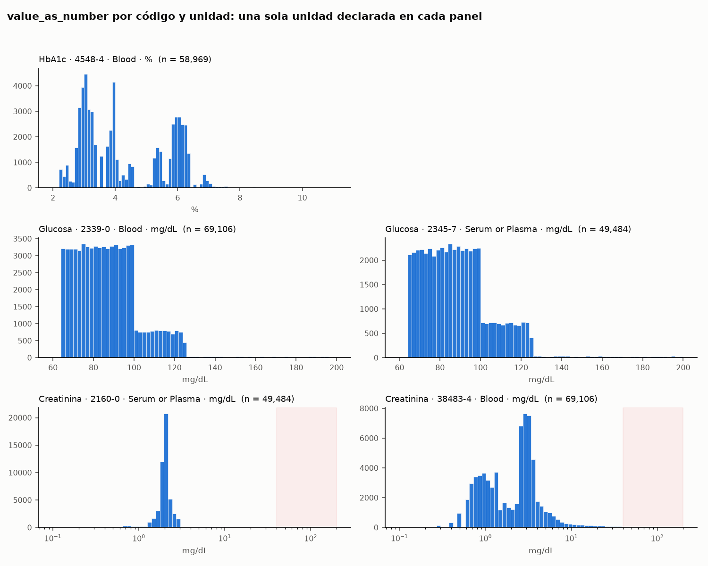

# Actividad 7 — Auditoría de unidades

Consultas: `actividades.sql`, actividades 7a (tabla), 7b (datos de los histogramas) y 7c (creatinina por estadio de ERC). Figura: `figura_unidades.png` (generada con `figura_unidades.py`). Decisiones 9 y 10 en `DECISIONES.md`.

**Alcance (decisión 9).** Se auditan los tres analitos de la actividad 5 con **todos sus códigos en uso**, no solo los tres códigos literales: glucosa = 2345-7 + 2339-0, creatinina = 2160-0 + 38483-4, HbA1c = concept set de la actividad 6 (en la base solo aporta 4548-4). Un analista que promedia «creatinina» junta los dos códigos, y la anomalía de creatinina está justo en el que no es de libro (38483-4).

## Unidades por analito

| Analito | Mediciones | Códigos en uso | Unidades distintas | Unidades | % sin unidad (0 o NULL) | % sin valor |
|---|---|---|---|---|---|---|
| Creatinina | 118,590 | 2 | 1 | mg/dL | 0.00 | 0.00 |
| Glucosa | 118,590 | 2 | 1 | mg/dL | 0.00 | 0.00 |
| HbA1c | 58,969 | 1 | 1 | % | 0.00 | 0.00 |

`unit_concept_id` coincide en todas las filas con `unit_source_value`. Total: 296,149 mediciones = 58,969 + 2 × 49,484 + 2 × 69,106, sin duplicados por el JOIN.

## Histogramas por código y unidad

| Código | System | Unidad | n | Mín | Mediana | Máx |
|---|---|---|---|---|---|---|
| 4548-4 | Blood | % | 58,969 | 2.3 | 4.0 | 10.9 |
| 2339-0 | Blood | mg/dL | 69,106 | 64.0 | 85.3 | 200.0 |
| 2345-7 | Serum or Plasma | mg/dL | 49,484 | 64.0 | 86.5 | 200.0 |
| 2160-0 | Serum or Plasma | mg/dL | 49,484 | 0.4 | 2.0 | 28.4 |
| 38483-4 | Blood | mg/dL | 69,106 | 0.2 | 2.5 | 130.6 |

- **Glucosa:** escalones planos (64-100, 100-125 y una cola hasta 200): rangos uniformes del generador, no una distribución biológica.
- **HbA1c:** forma de peine, con suelo en 2.3 %.
- **Creatinina en sangre (38483-4):** bimodal, con modas cerca de **1 y 3 mg/dL** (eje logarítmico). No es la trampa de µmol/L: esa daría una moda cerca de 90 (factor 88.4) y aquí la razón entre modas es ~3. Hay una cola de 232 mediciones ≥ 40 mg/dL (máx. 130.6) de 102 pacientes, zona sombreada en la figura.

## Validación: la moda alta de creatinina es enfermedad renal crónica

Cada medición recibe el estadio de ERC más alto diagnosticado **hasta su fecha** (decisión 10; estadios 1-4 y ERC terminal, descendientes de SNOMED 46271022 en `condition_occurrence`).

| Estadio a la fecha | 38483-4 sangre: mediciones | % en moda baja (< 1.6) | Mediana | ≥ 40 mg/dL | 2160-0 suero: mediana |
|---|---|---|---|---|---|
| Sin ERC | 21,852 | 75.7 | 1.1 | 0 | 2.6 |
| 1 | 3,582 | 76.0 | 1.2 | 0 | 1.6 |
| 2 | 8,189 | 24.4 | 2.0 | 0 | 2.0 |
| 3 | 11,738 | 0.6 | 3.6 | 0 | 2.0 |
| 4 | 14,106 | 10.1 | 3.1 | **232** | 2.3 |
| 5 (terminal) | 9,639 | 50.1 | 1.5 | 0 | 2.6 |

- En sangre, la creatinina sube con el estadio: la moda alta es ERC, no un problema de unidades.
- Las **232 mediciones ≥ 40 son todas de pacientes en estadio 4** a esa fecha. Un error de etiqueta (µmol/L cargado como mg/dL) afectaría a pacientes de cualquier estadio; esto es un extremo del generador, fisiológicamente implausible.
- En estadio 5 la mediana baja (1.5), compatible con diálisis o trasplante; no se investigó más.
- El código de **suero no sigue la función renal** (mediana ~2 en todos los estadios, 2.6 sin ERC): en Synthea los dos códigos de creatinina se comportan como variables distintas.

Nota de rendimiento: la CTE de diagnósticos va `MATERIALIZED`. Postgres (≥ 12) inserta en línea una CTE usada una sola vez; sin esa palabra la recalculaba por cada una de las 69,106 mediciones y la consulta no terminaba.

## ¿Se pueden promediar tal cual?

**HbA1c — sí, en cuanto a unidades.** Un solo código en uso, una sola unidad (%) y 0 % sin unidad. Pero el histograma tiene forma de peine con un suelo en 2.3 %, y los valores < 4 % son raros en la clínica real: es una cuestión de plausibilidad (lab 13), no de unidades, que conviene revisar antes de promediar.

**Glucosa — no, tal cual no**, aunque ambos códigos están en mg/dL. Mezclan sangre total y suero o plasma, y en datos reales la sangre total da ~11 % menos (en Synthea las medianas casi coinciden: 85.3 frente a 86.5). Además, en 24,827 persona-días hay una medición de cada código (actividad 5), así que el promedio contaría dos veces esos días. Hay que elegir un System o deduplicar por día.

**Creatinina — no, tal cual no.** La unidad es una sola y no hay µmol/L escondidos: la bimodalidad de 38483-4 es la ERC. Pero los dos códigos se comportan como variables distintas, comparten el problema de los días duplicados, y 38483-4 tiene 232 valores ≥ 40 mg/dL en pacientes en estadio 4 que son fisiológicamente implausibles y deben excluirse o marcarse.

**Idea central:** que haya una sola unidad es necesario, pero no suficiente, para promediar. La auditoría de unidades limpia la etiqueta; el System, los duplicados y la plausibilidad son otras capas de la misma pregunta.
