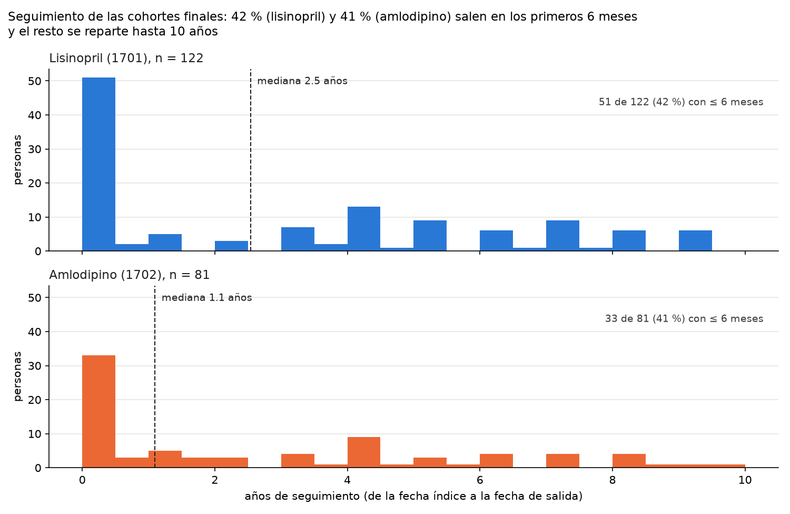

# Caracterización de la cohorte final — Lab 17

**Tabla 1** de las cohortes finales de la definición principal: 1701 (nuevos usuarios de lisinopril, 122 personas) y 1702 (nuevos usuarios de amlodipino, 81). La generó `tabla1.py` a partir de `results.cohort` (consultas en `caracterizacion.sql`); no hay cifras copiadas a mano. SMD es la diferencia estándar entre cohortes; `*` marca |SMD| > 0.1. La figura del seguimiento es `figura_seguimiento.png`.

| | Lisinopril (1701) | Amlodipino (1702) | SMD |
|---|---:|---:|---:|
| N | 122 | 81 |  |
| Edad en la fecha índice, años: mediana [Q1–Q3] | 40 [25–55] | 44 [25–56] |  |
| Edad en la fecha índice, años: media (DE) | 41.7 (16.6) | 43.6 (17.8) | -0.11 * |
| Edad 18–44 | 72 (59.0 %) | 43 (53.1 %) | +0.12 * |
| Edad 45–64 | 37 (30.3 %) | 24 (29.6 %) | +0.02 |
| Edad ≥ 65 | 13 (10.7 %) | 14 (17.3 %) | -0.19 * |
| Mujer | 71 (58.2 %) | 47 (58.0 %) | +0.00 |
| Hombre | 51 (41.8 %) | 34 (42.0 %) | +0.00 |
| Seguimiento, años: mediana [Q1–Q3] | 2.5 [0.1–5.1] | 1.1 [0.1–4.1] |  |
| Seguimiento, años: media (DE) | 3.1 (3.1) | 2.7 (2.9) | +0.13 * |
| Seguimiento total, años-persona | 373 | 216 |  |
| **Comorbilidades en [−365, 0]** (diez diagnósticos más frecuentes, clase Disorder) |  |  |  |
| Essential hypertension | 117 (95.9 %) | 81 (100.0 %) | -0.29 * |
| Gingivitis | 33 (27.0 %) | 23 (28.4 %) | -0.03 |
| Acute viral pharyngitis | 14 (11.5 %) | 10 (12.3 %) | -0.03 |
| Viral sinusitis | 13 (10.7 %) | 8 (9.9 %) | +0.03 |
| Metabolic syndrome X | 7 (5.7 %) | 11 (13.6 %) | -0.27 * |
| Acute bronchitis | 6 (4.9 %) | 8 (9.9 %) | -0.19 * |
| Hypertriglyceridemia | 5 (4.1 %) | 5 (6.2 %) | -0.09 |
| Sleep disorder | 5 (4.1 %) | 4 (4.9 %) | -0.04 |
| Dental caries | 4 (3.3 %) | 3 (3.7 %) | -0.02 |
| Acute infective cystitis | 6 (4.9 %) | 0 (0.0 %) | +0.32 * |

## Cómo se calculó cada cosa

- **Edad en la fecha índice.** Años cumplidos entre la fecha de nacimiento completa (año, mes y día) y `cohort_start_date` de cada persona, no contra hoy. La versión aproximada (año del índice − `year_of_birth`) sobreestima un año a quien aún no había cumplido años: difiere en 58 de las 203 personas (29 %), siempre por 1 año. Aquí solo cambia de grupo etario 1 persona, y nadie cruza los 18 años, pero el efecto puede ser mayor con cortes donde haya más gente alrededor.
- **Comorbilidades.** Las diez enfermedades (clase `Disorder`) más frecuentes en [−365, 0] respecto a la fecha índice, contando **personas distintas** (el JOIN con `condition_occurrence` trae una fila por registro; sin el `DISTINCT` una persona con muchas consultas se contaría muchas veces). Se descartan los hallazgos (`Clinical Finding`: aislamiento social, embarazo normal) (decisión 18).
- **Seguimiento.** Fecha de salida − fecha índice, de la actividad 6 (la mediana 928 y 401 días de esa actividad coincide: 2.5 y 1.1 años).

## Qué dice la tabla

1. **Las cohortes son jóvenes.** La mediana de edad es 40 y 44 años; el 59 % y el 53 % tienen menos de 45 y solo el 11 % y 17 % tienen 65 o más. Es una explicación plausible (no medida aquí) de que no haya demencias incidentes en estas cohortes, junto con el seguimiento corto: la demencia aparece sobre todo después de los 65 y con pocos mayores y poco seguimiento hay pocas oportunidades de verla.
2. **Los grupos no son idénticos, pero con este tamaño no se puede decir mucho.** 8 de 17 filas pasan de |SMD| 0.1. El error típico de un SMD con 122 y 81 personas es de unos 0.14, así que valores entre 0.1 y 0.3 son compatibles con el azar. Los mayores: hipertensión (95.9 % contra 100 %), síndrome metabólico (5.7 % contra 13.6 %) y cistitis aguda (4.9 % contra 0 %). La hipertensión no llega a 100 % en lisinopril porque 5 personas tienen su diagnóstico más de 365 días antes del índice (el criterio de inclusión usaba (−∞, 0], esta ventana es más corta).
3. **El seguimiento es muy corto y se concentra al inicio.** Mediana de 2.5 y 1.1 años; el 42 % y 41 % salen en los primeros 6 meses. Las 40 y 26 salidas por empezar el otro fármaco (actividad 6) caen todas en 98 días o menos, así que explican la mayor parte de ese grupo. Son 373 y 216 años-persona en total.
4. **La ventana de 365 días subestima las enfermedades crónicas.** Las enfermedades crónicas se registran una sola vez, al diagnosticarse. Con la historia completa (−∞, 0], la prediabetes la tienen 82 personas y con [−365, 0] solo 1; las caries, 108 contra 7; la anemia, 78 contra 5. La tabla muestra lo que se *registró en el último año*, no la carga de enfermedad: el top 10 queda dominado por infecciones agudas (gingivitis, faringitis, sinusitis, bronquitis). La hipertensión es la excepción porque es el criterio de entrada.
