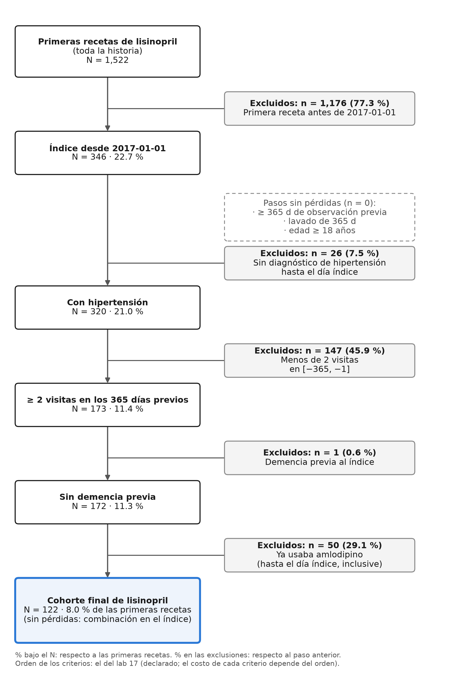
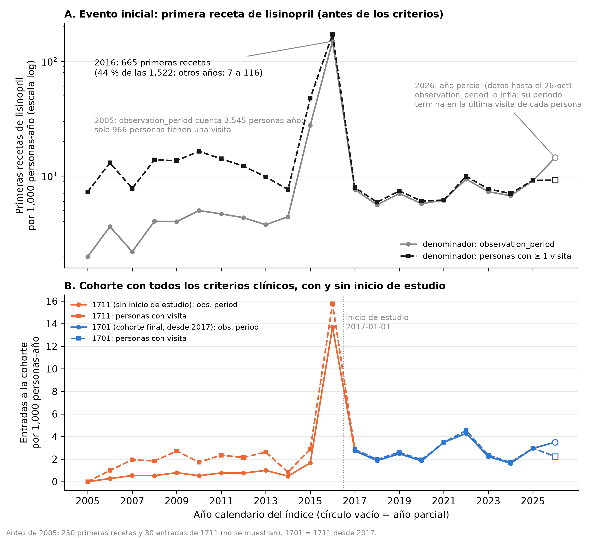
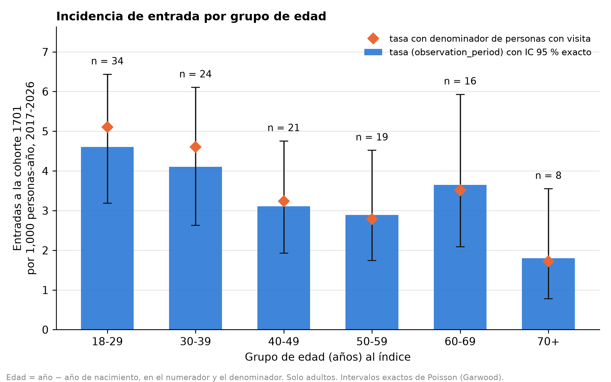
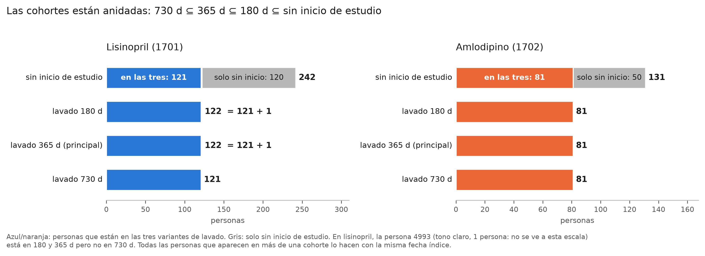

# Diagnóstico de la cohorte del lab 17

Auditoría de la cohorte de **nuevos usuarios de lisinopril con hipertensión** (`cohort_definition_id` 1701, índice desde 2017-01-01, N = 122) construida en el lab 17 sobre la base OMOP sintética del lab 12 (PostgreSQL, vocabulario v5.0 29-AUG-26). La cohorte 1702 (amlodipino, N = 81) se mide en paralelo cuando no cuesta nada. Todo el SQL es de solo lectura sobre `results.cohort` y `cdm`; las decisiones están en `DECISIONES.md`.

Contenido de este documento (se completa actividad por actividad):

1. [Factibilidad a posteriori](#1-factibilidad-a-posteriori)
2. [Tabla de atrición](#2-tabla-de-atrición)
3. [El orden importa](#3-el-orden-importa)
4. [Diagrama de flujo](#4-diagrama-de-flujo)
5. [Incidencia por año y por edad](#5-incidencia-por-año-y-por-edad)
6. [Qué códigos metieron a la gente](#6-qué-códigos-metieron-a-la-gente)
7. [Conceptos huérfanos](#7-conceptos-huérfanos)
8. [El SQL que no escribí: ATLAS y CIRCE](#8-el-sql-que-no-escribí-atlas-y-circe)
9. [Tres variantes de lavado](#9-tres-variantes-de-lavado)

---

## 1. Factibilidad a posteriori

Código: [`factibilidad.sql`](factibilidad.sql). Desenlace: primer diagnóstico de **demencia** (4182210 y descendientes) después del índice, el de la pregunta del lab 17.

### Los tres conteos

| | 1701 lisinopril | 1702 amlodipino |
|---|---|---|
| **1. Pacientes que entraron** | 122 | 81 |
| **2. Seguimiento tras el índice**, días: mediana [Q1–Q3] | 927.5 [30–1,869] | 401 [30–1,514] |
| Años-persona | 373.3 | 216.3 |
| **3. Eventos de demencia en ese seguimiento** | **0** | **0** |

El seguimiento es el tiempo entre el índice y la salida de la cohorte (incluye 30 días de persistencia y el corte al empezar el otro fármaco, decisiones 13 y 14 del lab 17). Filas = personas distintas en las dos cohortes: nadie está duplicado. Ninguna persona tiene demencia previa (0 y 0), como exige el criterio de exclusión del lab 17.

### Veredicto

**No, este estudio no es factible con estos datos.** Con 0 eventos no hay ni una variable que modelar: la regla de ~10 eventos por variable (Peduzzi et al., 1996) pide al menos 10 eventos para una sola variable, y la pregunta que decide es la 3, no la 1. Tener 122 pacientes es irrelevante si el desenlace no ocurre.

### Qué cambiaría: ¿la pregunta, el desenlace o la fuente?

Se probaron dos cosas para saber si el cero es un problema del diseño o de los datos:

1. **¿El cero lo causa el corte del seguimiento?** En parte. En 1701 hay **2 personas con demencia después de la salida** (a los 9 y 3 años; 61 y 74 años al índice). Las dos salieron de la cohorte por empezar amlodipino a los 30 y 91 días (censura por el otro fármaco, decisión 14 del lab 17). Si se las siguiera hasta el fin de su periodo de observación, sin cortar por el otro fármaco (solo como contraste, no es la definición del lab 17), 1701 tendría **2 eventos en 559 años-persona** (0.36 por 100 años-persona; IC 95 % exacto de Poisson 0.04–1.3) y 1702 tendría 0 en 329. El veredicto no cambia: 2 eventos siguen siendo una quinta parte de lo que pide una sola variable. Con esa tasa (muy imprecisa, son 2 casos) harían falta del orden de 2,800 años-persona para llegar a 10 eventos, unas 5 veces los que hay.
2. **¿Hay otro desenlace con eventos?** Tabla **exploratoria** (no sustituye al desenlace principal, decisión 4 de `DECISIONES.md`; los otros desenlaces se miraron después de ver que la demencia tenía 0):

   | Desenlace (incidente en 1701) | Eventos | Variables que soportaría |
   |---|---|---|
   | Enfermedad renal crónica | 13 | 1 |
   | Diabetes tipo 2 | 2 | 0 |
   | Infarto de miocardio | 1 | 0 |
   | Accidente cerebrovascular | 0 | 0 |
   | Demencia (principal) | 0 | 0 |

   «Incidente» = evento en el seguimiento en personas sin ese mismo diagnóstico antes del índice (sin esa exclusión, cada visita repetiría el código de una ERC que ya existía). Ni siquiera la ERC llega a un modelo con más de una variable.

**Qué cambiaría, en orden de importancia:**

- **La fuente (o la población), antes que el desenlace.** La base **sí tiene demencia** (170 de las 5,904 personas, el 2.9 %, tienen algún diagnóstico de demencia), pero la cohorte es joven: mediana de 40 años y solo el 11 % tiene 65 años o más (caracterización del lab 17). Un desenlace de aparición lenta y tardía necesita una población mayor y un seguimiento de muchos años. Una fuente con más pacientes mayores tendría más oportunidades de verlo.
- **El desenlace**, solo si la pregunta puede cambiar: para un estudio descriptivo con esta base, la enfermedad renal crónica tiene eventos, pero no los suficientes para estimar un efecto.
- **La pregunta (la comparación lisinopril contra amlodipino)** no es el problema: la definición es razonable. El problema es que no ocurre el desenlace.

**No se aflojó ningún criterio ni se rehízo la cohorte para conseguir eventos.** El enunciado pide trabajar con la cohorte que hay y documentar la limitación; esta es la limitación.

---

## 2. Tabla de atrición

Código: [`atricion.sql`](atricion.sql) (banderas), [`orden_lab17.sql`](orden_lab17.sql) (orden de los pasos), [`consulta_atricion.sql`](consulta_atricion.sql) y [`tabla_atricion.py`](tabla_atricion.py), que genera [`atricion_lab17.md`](atricion_lab17.md) con las comprobaciones.

### Cómo se construyó

En lugar de filtrar paso a paso, se calcula **una bandera (verdadero/falso) por criterio** para las personas con primera receta (1,522 en 1701), con el índice ya fijado. La atrición en un orden dado es un `AND` acumulado de esas banderas. Así reordenar los criterios (actividad 3) es cambiar el orden de una lista, sin reescribir el SQL (decisión 6). La primera receta de toda la historia **no** es una bandera: define cuál es el índice (decisión 6).

Las banderas se validaron contra `results.cohort` del lab 17 comparando **personas**, no solo conteos: la tupla (cohorte, persona, fecha índice) coincide en los dos sentidos (0 solo en las banderas, 0 solo en el lab 17, 122 y 81 en común; [`validacion_banderas.sql`](validacion_banderas.sql)). Cada bandera es una fila por persona, así que ningún `JOIN` duplica: filas = personas distintas en todas las cohortes.

**Orden declarado:** el del lab 17. Primero se fija el inicio de estudio y la observación previa, el lavado y la edad (criterios de la ventana); después los clínicos, de la inclusión (hipertensión, visitas) a la exclusión (demencia previa, otro fármaco, combinación). «% del inicial» es contra las 1,522 primeras recetas (decisión 7).

### Lisinopril (1701)

| paso | criterio | N | % del inicial | pérdida respecto al paso anterior |
|---:|---|---:|---:|---:|
| 0 | primera receta (toda la historia) | 1,522 | 100.0 % | — |
| 1 | índice desde 2017-01-01 | 346 | 22.7 % | −1,176 (77.3 %) |
| 2 | + 365 d de observación previa | 346 | 22.7 % | −0 (0.0 %) |
| 3 | + lavado de 365 d | 346 | 22.7 % | −0 (0.0 %) |
| 4 | + edad ≥ 18 | 346 | 22.7 % | −0 (0.0 %) |
| 5 | + hipertensión (−∞, 0] | 320 | 21.0 % | −26 (7.5 %) |
| 6 | + ≥ 2 visitas en [−365, −1] | 173 | 11.4 % | −147 (45.9 %) |
| 7 | − demencia previa | 172 | 11.3 % | −1 (0.6 %) |
| 8 | − otro fármaco previo | 122 | 8.0 % | −50 (29.1 %) |
| 9 | − combinación en el índice | 122 | 8.0 % | −0 (0.0 %) |

### Amlodipino (1702)

| paso | criterio | N | % del inicial | pérdida respecto al paso anterior |
|---:|---|---:|---:|---:|
| 0 | primera receta (toda la historia) | 1,104 | 100.0 % | — |
| 1 | índice desde 2017-01-01 | 238 | 21.6 % | −866 (78.4 %) |
| 2 | + 365 d de observación previa | 238 | 21.6 % | −0 (0.0 %) |
| 3 | + lavado de 365 d | 238 | 21.6 % | −0 (0.0 %) |
| 4 | + edad ≥ 18 | 238 | 21.6 % | −0 (0.0 %) |
| 5 | + hipertensión (−∞, 0] | 237 | 21.5 % | −1 (0.4 %) |
| 6 | + ≥ 2 visitas en [−365, −1] | 165 | 14.9 % | −72 (30.4 %) |
| 7 | − demencia previa | 164 | 14.9 % | −1 (0.6 %) |
| 8 | − otro fármaco previo | 81 | 7.3 % | −83 (50.6 %) |
| 9 | − combinación en el índice | 81 | 7.3 % | −0 (0.0 %) |

**La tabla cuadra:** la suma de pérdidas es 1,176 + 26 + 147 + 1 + 50 = 1,400 = 1,522 − 122 (1701) y 866 + 1 + 72 + 1 + 83 = 1,023 = 1,104 − 81 (1702); ningún paso aumenta el N. El script lo comprueba y se detiene si algo cambia.

### Qué criterio costó más y si ese precio vale la pena

**En la tabla, el que más cuesta es el inicio de estudio** (77.3 % y 78.4 % de las primeras recetas), pero esa cifra es en gran parte un efecto de ir primero: su **costo marginal** (cuántas personas más tendría la cohorte final sin ese criterio) es de solo 120 en 1701 y 50 en 1702 (sección 3), porque casi todos los anteriores a 2017 habrían salido igual por otro criterio. Tampoco es un criterio clínico: es una decisión sobre los datos. Antes de 2016 la base «observa» casi sin registros y las primeras recetas se acumulan en 2015-2016 (665 de las 1,522 en 2016 contra 36 en 2017), así que muchos «nuevos usuarios» de entonces ya tomaban el fármaco (lab 17, decisión 9). Sin ese corte la cohorte dejaría de ser de nuevos usuarios, así que el precio vale la pena para esta pregunta. Tiene un costo que aquí se ve: con índice desde 2017 el seguimiento máximo posible es de unos 9.8 años, y para un desenlace de aparición lenta como la demencia eso limita lo que la base puede mostrar (sección 1).

**Entre los criterios clínicos el más caro en la tabla fue «≥ 2 visitas en el año previo»** en lisinopril (147 de 320, el 45.9 %), y «otro fármaco previo» en amlodipino (83 de 164, el 50.6 %). Por costo marginal el orden es el mismo: las visitas (+133) en 1701 y «otro fármaco» (+82) en 1702. El de las visitas es el más discutible: su propósito es asegurar que se observaba a la persona (una sola visita puede ser la del propio diagnóstico), pero es un sustituto de la observación real y cuesta casi la mitad de quienes llegaban. Con N = 1 el lab 17 midió que habría quitado 80 en vez de 147 (decisión 11 de ese lab); con N = 3, 207. La exclusión del otro fármaco sí tiene una razón de diseño fuerte (quien inicia los dos no es nuevo usuario de uno solo), así que su costo, aunque alto, es el precio del diseño.

**Tres criterios no quitaron a nadie** (observación previa, lavado y edad ≥ 18), ni siquiera en las 1,522 personas con primera receta: la observación previa de 365 días no filtra porque `observation_period` abarca toda la historia (lab 17, control 0a), y el lavado no quita a nadie por construcción porque el índice es la primera receta de toda la historia. Son criterios correctos de la definición que, en esta base, no cambian el resultado.

**Advertencia sobre estas lecturas:** el costo de cada criterio en la tabla depende del orden en que se aplicó. La sección 3 lo comprueba reordenando y mide el costo marginal, que no depende del orden: el inicio de estudio, que parece costar 1,176 personas, solo cuesta 120.

---

## 3. El orden importa

Código: [`orden_b.sql`](orden_b.sql), [`consulta_aislado.sql`](consulta_aislado.sql), [`consulta_marginal.sql`](consulta_marginal.sql), [`contraejemplo_indice.sql`](contraejemplo_indice.sql) y [`tabla_orden.py`](tabla_orden.py), que genera [`atricion_ordenes.md`](atricion_ordenes.md) (con 1702 completo) y comprueba lo que se afirma aquí.

### Qué se reordenó

Dos criterios clínicos: **«≥ 2 visitas en [−365, −1]»** y **«sin otro fármaco previo»** (decisión 8). En el orden A (el del lab 17) las visitas van en el paso 6 y el otro fármaco en el 8; en el orden B se intercambian. Los demás pasos no se mueven, así que las tablas son idénticas hasta el paso 5.

### Las dos tablas, lado a lado (lisinopril, 1701)

| paso | orden A: criterio | N | pérdida | orden B: criterio | N | pérdida |
|---:|---|---:|---:|---|---:|---:|
| 0 | primera receta (toda la historia) | 1,522 | — | primera receta (toda la historia) | 1,522 | — |
| 1 | índice desde 2017-01-01 | 346 | −1,176 | índice desde 2017-01-01 | 346 | −1,176 |
| 2 | + 365 d de observación previa | 346 | −0 | + 365 d de observación previa | 346 | −0 |
| 3 | + lavado de 365 d | 346 | −0 | + lavado de 365 d | 346 | −0 |
| 4 | + edad ≥ 18 | 346 | −0 | + edad ≥ 18 | 346 | −0 |
| 5 | + hipertensión (−∞, 0] | 320 | −26 | + hipertensión (−∞, 0] | 320 | −26 |
| 6 | **+ ≥ 2 visitas en [−365, −1]** | 173 | **−147** | **− otro fármaco previo** | 257 | **−63** |
| 7 | − demencia previa | 172 | −1 | − demencia previa | 255 | −2 |
| 8 | **− otro fármaco previo** | 122 | **−50** | **+ ≥ 2 visitas en [−365, −1]** | 122 | **−133** |
| 9 | − combinación en el índice | 122 | −0 | − combinación en el índice | 122 | −0 |

### Verificación: el N final es el mismo

**El N final es 122 en los dos órdenes** (y 81 en 1702, donde el orden B da 135 → 81 en lugar de 165 → 81). La pérdida total también coincide (1,400). Los criterios son **independientes** en el sentido que importa: cada bandera depende solo de la persona y de su fecha índice, no de quién más se quedó antes. El N final es el tamaño de la **intersección** de los nueve conjuntos de personas que cumplen cada criterio, y una intersección no depende del orden en que se calcula. Si el N final cambiara al reordenar, algún criterio estaría usando información de los pasos previos (por ejemplo, contar visitas solo entre quienes ya sobrevivieron un filtro) y la definición dependería del orden, no solo la tabla.

### Lo que sí cambia: el «costo» de cada criterio

| criterio (1701) | falla solo, de las 1,522 | pérdida en orden A | pérdida en orden B | costo marginal |
|---|---:|---:|---:|---:|
| índice desde 2017-01-01 | 1,176 | 1,176 | 1,176 | +120 |
| hipertensión (−∞, 0] | 75 | 26 | 26 | +22 |
| **≥ 2 visitas en [−365, −1]** | 1,035 | **147** | **133** | +133 |
| demencia previa | 18 | 1 | 2 | +1 |
| **otro fármaco previo** | 576 | **50** | **63** | +49 |
| combinación en el índice | 14 | 0 | 0 | +0 |

*Observación previa, lavado y edad (0 en todas las columnas) no se muestran. **Costo marginal** = personas que se sumarían a la cohorte final (122) si ese criterio, y solo ese, se quitara de la definición. No depende del orden. La tabla completa y 1702 están en [`atricion_ordenes.md`](atricion_ordenes.md).*

- Los dos criterios intercambiados cambian: «otro fármaco» pasa de costar 50 a 63 al ir antes, y las visitas de 147 a 133 al ir después. En amlodipino el efecto es mayor: «otro fármaco» pasa de 83 a 102 y las visitas de 72 a 54.
- **También cambia un criterio que no se movió:** «demencia previa» pasa de −1 a −2 (en amlodipino, de −1 a 0). Se explica por el único paso distinto antes de ella, el 6: en el orden A ahí van las visitas, y una persona con demencia previa y pocas visitas salía ya en ese paso; en el B ahí va «otro fármaco», y esa persona sigue hasta que la quita la demencia. En amlodipino ocurre lo contrario: la persona con demencia previa ya había salido por «otro fármaco», que ahora va antes. Esto es lo que impide hablar de un costo «propio» de cada criterio.
- La columna «falla solo» es el otro extremo: sin importar el orden, las visitas dejarían fuera a **1,035** de las 1,522 personas. En secuencia solo cuestan 147 o 133 porque la mayoría ya salió por el inicio de estudio (muchas de las primeras recetas son anteriores a 2017, cuando casi no hay visitas registradas). El costo en una tabla de atrición **no es una propiedad del criterio**: es la parte de su efecto que los pasos anteriores no habían ya producido.

### El costo marginal: la medida que no depende del orden

Las tres columnas responden preguntas distintas. «Falla solo» dice cuánta gente incumple el criterio (1,035 para las visitas). La pérdida en la tabla dice cuánta quita **después de los pasos anteriores** (147 o 133, según la ruta). El **costo marginal** dice cuánta gente ganaría la cohorte final si se quitara ese criterio y se dejaran los demás: **+133** en las visitas. Es lo que contesta «¿cuánto cuesta realmente este criterio?», y se puede reproducir sin saber en qué orden se aplicó.

- **La relación entre las tres:** el costo marginal es siempre menor o igual que lo que el criterio quita en la tabla, en cualquier posición, y es igual cuando va **último**. Por eso las visitas muestran exactamente +133 en el orden B (donde van al final, salvo «combinación», que quita 0) y «otro fármaco» muestra 50 contra +49 (la diferencia de 1 es una persona que falla «otro fármaco» y «combinación» a la vez). El script comprueba estas dos propiedades.
- **El inicio de estudio es el caso extremo:** parece costar 1,176 personas (77 %), pero quitarlo solo recuperaría **120** (la cohorte pasaría de 122 a 242, la cohorte 1711 del lab 17). Los otros 1,056 que salen en ese paso habrían salido igual por visitas, otro fármaco u otro criterio. Su costo en la tabla es casi todo solapamiento por ir primero.
- **En 1702 el ranking es otro:** el mayor costo marginal es «otro fármaco» (+82), seguido de las visitas (+54) y el inicio de estudio (+50).

**Por eso el orden se declara**: «las visitas costaron 147 personas» sin decir en qué paso se aplicaron no se puede reproducir ni comparar. Para hablar del costo de un criterio, lo que se reporta es el **costo marginal** (y el orden de la tabla, si se muestra).

### Lo que no es reordenar: el índice

Hay un cambio que **sí** alteraría el N final y que no es un criterio más: filtrar por fecha **antes** de tomar la primera receta. Cambia cuál es el índice: 1,233 personas en 1701 y 934 en 1702 tendrían alguna receta desde 2017, contra 346 y 238 con la primera de toda la historia. La diferencia (887 y 696) son usuarios previos que pasarían por «nuevos». Por eso en la actividad 2 la primera receta es el paso 0 y no una bandera.

---

## 4. Diagrama de flujo

Código: [`figura_consort.py`](figura_consort.py). Genera [`figura_consort_1701.png`](figura_consort_1701.png) (lisinopril) y [`figura_consort_1702.png`](figura_consort_1702.png) (amlodipino) a 300 dpi desde la misma tabla de atrición de la sección 2.



**Pie de figura (para la tesis):** Diagrama de flujo de la cohorte de nuevos usuarios de lisinopril con hipertensión. Las cajas centrales muestran el N tras cada criterio, aplicados en el orden indicado; las cajas de la derecha, las personas excluidas en cada paso y el motivo. Los porcentajes bajo el N son respecto a las 1,522 primeras recetas; los de las exclusiones, respecto al paso anterior. Los criterios que no excluyeron a nadie (observación previa ≥ 365 días, lavado de 365 días, edad ≥ 18 y combinación en el índice) se indican aparte.

**Decisiones de forma** (decisión 10):

- **Los pasos sin pérdidas no son cajas.** Observación previa, lavado, edad y combinación en el índice quitan 0; dibujarlos como cajas repetiría el mismo N y ocuparía espacio. Van como una nota punteada junto a la flecha y, el último, en la caja final. Se declaran en la figura para que quien la lea sepa que se aplicaron.
- **Cada caja nombra el criterio, no solo el número.** Una figura con «N = 320» sin decir qué paso la produjo no se entiende sin la tabla.
- **El orden es el del lab 17**, y la figura lo dice al pie: el costo de cada criterio depende del orden (sección 3), y un diagrama de flujo siempre fija uno.
- **Las cifras salen de la base, no se escriben a mano.** El script se detiene si cambian el N inicial o final, o si las pérdidas dibujadas no suman lo que se fue entre el inicio y el final (1,400 en 1701; 1,023 en 1702).

---

## 5. Incidencia por año y por grupo de edad

Código: [`incidencia.sql`](incidencia.sql) (numeradores y denominadores) y [`figura_incidencia.py`](figura_incidencia.py), que calcula las tasas, comprueba las cifras y genera [`figura_incidencia_anio.png`](figura_incidencia_anio.png), [`figura_incidencia_edad.png`](figura_incidencia_edad.png) y [`incidencia_tablas.md`](incidencia_tablas.md) (todas las cifras).

### Qué se mide

Una incidencia es entradas entre el tiempo en que la gente podía entrar: **tasa por 1,000 personas-año**. Para el año calendario se grafican dos cosas (decisión 11): las **primeras recetas** de lisinopril (el evento inicial, antes de los criterios, 1,522 en total) y las cohortes con todos los criterios clínicos, con inicio de estudio (**1701**, 122) y sin él (**1711**, 242). Las primeras recetas son lo único que permite ver el pico del inicio de la base, porque la cohorte final lo excluye por construcción (índice desde 2017). Se usan **dos denominadores** (decisión 12): las personas-año de `observation_period` (el estándar OHDSI) y las personas con al menos una visita en el año (en 2026, ponderadas por la fracción del año cubierta, 0.82). Lo que diferencia a los dos es parte del diagnóstico.

### Por año calendario



| año | personas-año OP | personas con visita | primeras recetas | tasa (OP) | tasa (visita) | 1711 | 1701 |
|---:|---:|---:|---:|---:|---:|---:|---:|
| 2005 | 3,545 | 966 | 7 | 2.0 | 7.0 | 0 | 0 |
| 2013 | 3,997 | 1,528 | 15 | 3.8 | 9.8 | 4 | 0 |
| 2015 | 4,195 | 2,436 | 116 | 27.7 | 47.6 | 7 | 0 |
| **2016** | 4,450 | 3,868 | **665** | **149.5** | **171.9** | 61 | 0 |
| 2017 | 4,732 | 4,541 | 36 | 7.6 | 7.9 | 13 | 13 |
| 2025 | 4,749 | 4,697 | 43 | 9.1 | 9.2 | 14 | 14 |
| 2026* | 2,285 | 4,383 | 33 | 14.4 | 9.2 | 8 | 8 |

\* año parcial (datos hasta el 2026-10-26). Cifras de 2005-2026 completas en `incidencia_tablas.md`; antes de 2005 hay 250 primeras recetas que no se grafican.

### Interpretación: qué dicen los datos (no la enfermedad)

Todo lo que se ve es información sobre cómo está construida la base, no sobre la hipertensión ni su tratamiento:

1. **Un pico artificial en 2016.** Las primeras recetas pasan de 7 a 19 por año (2005-2014) a 116 en 2015 y **665 en 2016**, el 44 % de todas las primeras recetas de la historia, y vuelven a 36 en 2017. No fue una epidemia: coincide con el salto de las visitas registradas (de ~4,000 a ~24,000 por año en 2016-2017, lab 17) y con el escalón de las personas con visita (1,528 en 2013, 2,436 en 2015, 3,868 en 2016, 4,541 en 2017). Muchos «nuevos usuarios» de 2015-2016 ya tomaban el fármaco y aparecen como nuevos porque antes no se registraba. **El pico sobrevive a los criterios clínicos**: la cohorte 1711 (todos los criterios, sin inicio de estudio) tiene 61 entradas en 2016, contra 2 a 4 por año en 2008-2014. Por eso el inicio de estudio en 2017 (decisión del lab 17) es lo que lo elimina, y los criterios no.
2. **`observation_period` sobreestima a la población observada al inicio.** En 2005 declara 3,545 personas-año pero solo 966 personas tienen una visita (27 %). La tasa calculada con `observation_period` (2.0 por 1,000) es 3.5 veces menor que con el denominador de personas con visita (7.0). Las dos líneas convergen hacia 2016-2017, cuando casi todos los observados tienen visitas (control 0c del lab 17). Con el denominador estándar, las tasas anteriores a 2014 están **subestimadas**.
3. **Un efecto de borde en el último año, y su causa es la regla de censura de la base.** En 2026 la tasa con `observation_period` se dispara a 14.4 (la de 1701, a 3.5), pero con el denominador de visitas queda en 9.2 (y 2.2). El año incompleto (datos hasta el 26-oct) **no es la causa por sí solo**: las personas-año se miden en días, así que 10 meses cuentan 10 meses. La causa es dónde termina el periodo de cada persona ([`control_fin_observacion.sql`](control_fin_observacion.sql)): **`observation_period` termina en la última visita** (5,789 de 5,904, el 98.1 %) **o el día de la muerte** (825 de las 829 defunciones registradas). Consecuencias para 2026: 1,518 personas no tienen ningún día observado porque su periodo terminó antes (805 murieron, y se excluyen con razón; 713 no tienen muerte registrada, de ellas 541 con última visita en 2025 y 172 antes) y, de las 4,386 que sí llegan a 2026, solo **58** están observadas hasta la fecha de corte: el resto aporta tiempo solo hasta su última visita. Por eso las personas-año caen a 2,285 (4,749 en 2025) aunque 4,383 personas tienen visitas en 2026. Es una **censura en el último contacto**: no se sabe si quien no ha vuelto sigue en la población o se fue. Los dos denominadores **acotan** la tasa real del año parcial; para decidir cuál está más cerca habría que saber si esas 713 personas siguen en riesgo de iniciar el fármaco. Solo afecta al último año: en los demás, el periodo de la mayoría continúa después y el denominador no se trunca. (115 personas, el 1.9 %, tienen el fin entre 1 y 343 días después de su última visita; en 64 coincide con el fin de su última receta. El resto, al menos 36, no se investigó.)
4. **Desde 2017 no hay tendencia clara.** Las entradas a 1701 van de 8 a 21 por año (1.6 a 4.3 por 1,000 personas-año); con tan pocos casos, el ruido de Poisson es de alrededor de ±25 %, así que el máximo de 2022 (21 entradas) no se interpreta.

### Por grupo de edad



| grupo | personas-año OP | entradas | tasa por 1,000 [IC 95 %] | tasa con visita |
|---|---:|---:|---:|---:|
| 18-29 | 7,384 | 34 | 4.60 [3.19–6.43] | 5.11 |
| 30-39 | 5,848 | 24 | 4.10 [2.63–6.11] | 4.61 |
| 40-49 | 6,752 | 21 | 3.11 [1.93–4.75] | 3.23 |
| 50-59 | 6,567 | 19 | 2.89 [1.74–4.52] | 2.79 |
| 60-69 | 4,383 | 16 | 3.65 [2.09–5.93] | 3.51 |
| 70+ | 4,440 | 8 | 1.80 [0.78–3.55] | 1.73 |

**Interpretación.** La tasa **baja** con la edad (4.6 en 18-29 contra 1.8 en 70 o más), al revés de lo esperable clínicamente para un fármaco antihipertensivo. Pero los intervalos se superponen casi por completo (solo el primero y el último apenas se rozan: 3.19-6.43 contra 0.78-3.55), así que con 122 entradas esto es, como mucho, una señal débil, y ninguna diferencia entre grupos intermedios es distinguible del azar. Dos explicaciones plausibles, **que esta actividad no distingue**:

- **El denominador no es de personas «en riesgo».** Incluye a quienes ya habían usado lisinopril antes y no pueden ser «nuevos usuarios». Es más probable que sean mayores, así que la tasa de los grupos mayores está subestimada. Un denominador correcto excluiría el tiempo después de la primera receta; con las personas-año de `observation_period` no se hace (limitación de esta tasa).
- **Composición de la base**: la cohorte tiene mediana de 40 años y solo el 11 % tiene 65 o más (lab 17), lo que ya limitaba la factibilidad (sección 1).

**Qué se puede concluir sobre los datos:** (a) el pico de 2016 es un artefacto de captura y el inicio de estudio de 2017 es una decisión bien fundamentada; (b) `observation_period` no es una medida fiable de la población observada ni al inicio ni en el último año, y cualquier análisis de tiempo sobre esta base debe declararlo; (c) por edad no hay evidencia sólida de diferencias con este tamaño.

---

## 6. Qué códigos metieron a la gente

Código: [`codigos_indice.sql`](codigos_indice.sql) (cinco consultas) y [`tabla_codigos.py`](tabla_codigos.py), que las ejecuta, comprueba las cifras y genera [`codigos_indice.md`](codigos_indice.md).

### Qué se mide

«Entrar por un código» es el **producto de la receta del día índice** (`drug_concept_id`), dentro del concept set: el ingrediente (lisinopril, amlodipino) y todos sus descendientes en `concept_ancestor`, como en el lab 17. Se cuentan **personas distintas** (decisión 14). Control: cada persona entra por un solo producto (0 personas con más de uno, en las dos cohortes), así que la tabla suma exactamente el N de la cohorte.

### La tabla, ordenada

**Lisinopril (1701), N = 122**

| concept_id | producto | personas | % | % acumulado |
|---:|---|---:|---:|---:|
| 19080128 | lisinopril 10 MG Oral Tablet | 120 | **98.4** | 98.4 |
| 1308251 | lisinopril 5 MG Oral Tablet | 2 | 1.6 | 100.0 |

**Amlodipino (1702), N = 81**

| concept_id | producto | personas | % | % acumulado |
|---:|---|---:|---:|---:|
| 19073094 | amlodipine 2.5 MG Oral Tablet | 81 | **100.0** | 100.0 |

**El concepto más frecuente aporta el 98.4 % de la cohorte de lisinopril y el 100 % de la de amlodipino.**

### Lo que esto significa

**Tu definición es, en la práctica, ese código, y el resto del concept set es decorativo.** El concept set de lisinopril tiene **98 conceptos** (el ingrediente y 97 descendientes: productos clínicos y de marca, componentes, formas y grupos de dosis); solo **9** tienen una receta en toda la base y solo **2** son el producto de algún índice. El de amlodipino es aún más inflado: **303 conceptos, 6 con recetas y 1 como índice**. Ninguna marca (*Branded Drug*) tiene una sola receta; la base solo usa productos genéricos (*Clinical Drug*). Que el concept set sea tan grande no hace a la cohorte más sensible a otras presentaciones: simplemente no hay recetas con ellas.

**La concentración no la crea la definición de la cohorte: ya está en la base.** Entre **todas** las recetas, el 98.1 % de las de lisinopril (41,278 de 42,085) y el 99.97 % de las de amlodipino (34,464 de 34,475) son del mismo producto. La definición hereda esa concentración:

| etapa | lisinopril: % del producto más frecuente | amlodipino |
|---|---:|---:|
| todas las recetas | 98.1 | 100.0 |
| primeras recetas (toda la historia) | 93.0 | 99.7 |
| cohorte sin inicio de estudio | 94.6 | 100.0 |
| **cohorte final** | **98.4** | **100.0** |

**Un matiz en lisinopril:** el 93.0 % de las primeras recetas sube a 98.4 % en la cohorte final porque quienes inician con **otro producto** (107 personas: otras dosis y combinaciones) casi no llegan: 79 de ellas tienen el índice antes de 2017 (inicio de estudio) y de las 28 restantes solo **2** llegan al final, contra 120 de 318 en quienes inician con 10 mg. Parte es la exclusión de combinaciones (14 personas con lisinopril/hidroclorotiazida, decisión 12 del lab 17); el resto no se investigó.

**Qué implica para la cohorte:**

- **No se puede estudiar la dosis.** Con 98.4 % de los usuarios en 10 mg (y todos los de amlodipino en 2.5 mg, la dosis más baja de las presentaciones habituales, lo cual sugiere que el ETL codifica una presentación única por fármaco), no hay variabilidad de dosis ni de presentación que describir ni usar como covariable.
- **La definición depende de cómo codifica la base.** Con otra fuente, con marcas o con más dosis, el mismo concept set daría otra cohorte. Para esta base, «nuevo usuario de lisinopril» es en la práctica «nuevo usuario de lisinopril 10 mg en tabletas».
- **La definición está bien; lo que hay que hacer es declararlo.** Como el concept set por ingrediente + descendientes es la forma estándar de especificar un fármaco, no hace falta cambiarlo: sí hace falta decir que casi no hay variabilidad en su contenido.

---

## 7. Conceptos huérfanos

Código: [`huerfanos.sql`](huerfanos.sql) (seis consultas), [`huerfanos_pa.sql`](huerfanos_pa.sql) y [`huerfanos_preeclampsia.sql`](huerfanos_preeclampsia.sql) (impacto en la cohorte, se pegan después del bloque de banderas) y [`tabla_huerfanos.py`](tabla_huerfanos.py), que los ejecuta, comprueba las cifras y genera [`huerfanos.md`](huerfanos.md).

Un huérfano es un código que aparece con frecuencia en la base, se parece a lo que buscabas y **no** está en tu concept set. Es el único diagnóstico que detecta lo que **falta**; los demás auditan lo que ya pusiste. Se buscó por tres vías: texto en `CONCEPT` (el método de la actividad, en dos niveles: el nombre mismo y términos cercanos), códigos fuente y registros sin mapear (lo que hace CohortDiagnostics además del texto), y otras tablas (mediciones).

### Qué se encontró

- **Por texto, ningún huérfano en el fármaco, el comparador, la hipertensión ni la demencia** en el nivel estricto, y ninguno en el ampliado de la demencia. Los concept sets por ingrediente más `concept_ancestor` ya cubren todo lo que dice «lisinopril», «amlodipine», «hypertens», «dementia» o «alzheimer» y tiene registros.
- **Sin mapear y códigos fuente: 0.** No hay condiciones ni recetas sin mapear (concepto 0), ni valores fuente que mencionen lo buscado y estén fuera del set.
- **El único huérfano real viene de otra tabla**: las mediciones de presión arterial (ver abajo). En el nivel ampliado de hipertensión aparecen además cuatro conceptos por texto, y hay un intruso dentro del set.

### Decisión por cada candidato

| candidato | qué es | personas | impacto en tu cohorte | decisión |
|---|---|---:|---|---|
| **Presión arterial elevada sin diagnóstico** (candidato real) | sistólica ≥ 140 o diastólica ≥ 90 en ≥ 2 fechas, sin diagnóstico de hipertensión | 915 en la base (44 % de quienes tienen presión elevada) | +3 de 122 (122 → 125); de 0 a 7 según el umbral | **No entra** (se reporta como limitación) |
| «Pre-eclampsia» (439393), **intruso** dentro del set | trastorno hipertensivo del embarazo | 85 (62 solo por él) | 0 | **Se mantiene el set y se declara** |
| «Eclampsia in pregnancy» (137613), huérfano | trastorno hipertensivo del embarazo, fuera del set | 120 | 0 | No entra |
| Microalbuminuria / proteinuria por diabetes tipo 2 (45769905, 45757499) | complicación renal de la diabetes, coincide por «albuminuria/proteinuria» | 792 y 613 | no medido (no es hipertensión) | No entra (falso positivo del término ampliado) |
| «Blood pressure within reference range» (4065875) | presión **normal** | 3 | no medido | No entra (falso positivo textual) |
| Otros IECA (ramipril 14, enalapril 13, benazepril 9, quinapril 2) | otros fármacos de la clase | ≤ 14 | — | No son huérfanos: la pregunta es lisinopril, no la clase |

**Presión arterial elevada sin diagnóstico: por qué no entra (decisión 15).** Es un candidato real: toda la base tiene mediciones de presión y 915 personas tienen presión elevada en al menos dos fechas sin ningún diagnóstico de hipertensión. Si se aceptara, de las 22 personas que fallan *solo* el criterio de hipertensión, 3 entrarían (122 → 125). No entra por cuatro razones: (1) la definición principal se declaró sin cambios en el paso 0, antes de ver los resultados, y cambiarla ahora es lo que esa declaración quería evitar; (2) el criterio de población del lab 17 es por **diagnóstico**, y uno basado en mediciones es otra definición, con su umbral y su número de fechas; (3) el resultado **depende de ese umbral**: con ≥ 2 fechas, 7 personas con 130/80, 3 con 140/90 y 0 con 160/100, de modo que el N de una definición con presión sería arbitrario; (4) una medición alta puntual no equivale a un diagnóstico (consulta, dolor, estrés). Queda como **limitación**: el 44 % de quienes tienen presión elevada no tiene diagnóstico de hipertensión, lo que sugiere que el diagnóstico puede estar subcodificado y que «hipertensión por diagnóstico» deja fuera a gente con la enfermedad.

**Pre-eclampsia dentro del set (decisión 16).** El código 439393 es descendiente de «Hypertensive disorder» (316866), así que cuenta como hipertensión para el criterio, aunque es un trastorno del embarazo, transitorio y distinto de la hipertensión crónica. 62 personas de la base cumplirían el criterio solo por él, pero ninguna llega a tu cohorte (0 entre las primeras recetas y 0 en la final). Como el impacto es 0, se **mantiene el concept set del lab 17 sin cambios** y se declara; si el set se reutiliza en otra cohorte conviene excluir 439393. La misma lógica vale para «Eclampsia in pregnancy», que no está en el set: ninguna de las personas que fallan solo el criterio de hipertensión lo tiene. Que un trastorno hipertensivo del embarazo esté dentro del set y otro fuera muestra que el set no es coherente en ese punto, pero ninguno de los dos debería definir hipertensión crónica.

**Lo que no se hizo:** no se comparó con la definición publicada en la OHDSI Phenotype Library (el recurso lo propone como referencia); queda pendiente. Tampoco se consideró cada concepto del vocabulario: la búsqueda es por texto, y un código sin parecido de nombre con lo buscado no aparecería.

---

## 8. El SQL que no escribí: ATLAS y CIRCE

Código: [`comparar_atlas.py`](comparar_atlas.py) y [`atlas_impacto.sql`](atlas_impacto.sql), que generan [`comparacion_atlas.md`](comparacion_atlas.md). El SQL exportado por ATLAS (`atlas_export.sql`) **no se versiona** (está en el `.gitignore`: el enunciado pide no copiarlo, es largo y está escrito para cinco motores); `comparar_atlas.py` avisa y sale si no existe. Las referencias a líneas son del export del 2026-11-15.

### Qué se reconstruyó

La cohorte 1701 en la demo pública de ATLAS (datos sintéticos; solo para exportar el SQL). Cuatro concept sets con *Include Descendants* (lisinopril 1308216, amlodipino 1332418, *Hypertensive disorder* 316866, demencia 4182210) y uno de visitas (9201, 9202, 9203).

| elemento | en ATLAS | en el SQL del lab 17 |
|---|---|---|
| Evento inicial | Drug Exposure, lisinopril; primer evento por persona; observación continua 365 días antes, 0 después | primera receta de la historia; `obs_previa` |
| Adulto | Demographic: edad ≥ 18 | año del índice − `year_of_birth` ≥ 18 |
| Hipertensión | Condition Occurrence, al menos 1, de *all days before* a 0 *days after* | (−∞, 0], con el día 0 |
| Dos visitas | Visit Occurrence (cualquiera), al menos 2, de 365 a 1 día antes | [−365, −1] |
| Sin demencia / sin amlodipino | exactamente 0, de *all days before* a 0 *days after* | (−∞, 0] |
| Inicio de estudio | **regla de inclusión** sobre la fecha del índice ≥ 2017-01-01 | `periodo_estudio`, después de la primera receta |
| Salida | fin de exposición continua al lisinopril, *persistence window* 30; censura con amlodipino | tramo con hueco de 30 días, +30 días, corte por amlodipino |
| *Collapse Settings* | por defecto: `ERA`, `EraPad` 0 | — |

**No se expresó** el lavado de 365 días (vacío por construcción con la primera receta de la historia, actividad 4 del lab 17) ni «sin combinación en el índice» (no tiene equivalente directo en la interfaz).

### Resultado de la comparación

El SQL exportado se ejecutó contra la base (sustituyendo los marcadores `@...` por los esquemas, con el destino en una tabla temporal de la sesión: no se escribe nada persistente) y se comparó con `results.cohort` persona por persona (decisión 17):

| *surveillance window* | personas ATLAS | en ambas | solo ATLAS | solo 1701 | misma fecha índice | misma fecha de salida |
|---:|---:|---:|---:|---:|---:|---:|
| 0 | 122 | 122 | 0 | 0 | 122 | 67 |
| 30 | 122 | 122 | 0 | 0 | 122 | **122** |

**Las dos definiciones entran exactamente igual:** las mismas 122 personas con la misma fecha índice, incluidas las reglas de observación, hipertensión, visitas, demencia, amlodipino y el inicio de estudio. El inicio de estudio como **regla de inclusión** fue la decisión correcta: ATLAS fija «la primera» antes de las reglas (`WHERE P.ordinal = 1`, líneas 64-87) y aplica la fecha después (línea 337), el mismo orden que el SQL del lab 17; como atributo del evento inicial habría filtrado antes de tomar la primera y habría dado otra cohorte.

**La salida es lo único que difería, y es un parámetro de ATLAS.** Con el *surveillance window* en 0 (primer intento), la salida coincidía en 67 de 122: en 23 diferían exactamente 30 días y en 32 la salida de 1701 es el fin del periodo de observación y la de ATLAS queda entre 1 y 28 días antes. La causa: el SQL del lab 17 **añade 30 días** después del fin de la exposición, y en ATLAS eso no es el *persistence window* (que solo **une** recetas con huecos de hasta 30 días) sino el ***surveillance window*** (el desplazamiento). Con el *surveillance* en 30, las 122 salidas coinciden.

### Tres cosas que CIRCE hace y yo no

1. **Recorta todas las ventanas al periodo de observación (A).** CIRCE exige que cada diagnóstico, visita o receta de un criterio caiga dentro de `[OP_START_DATE, OP_END_DATE]` y descarta cualquier registro fuera de observación (líneas 161, 206, 254 y 302 del export). En mis 122 pacientes el impacto es 0 (ninguno tiene diagnósticos de hipertensión previos al periodo, aunque en toda la base hay 614 diagnósticos de cualquier tipo anteriores al inicio del periodo), pero importa en otra fuente: evita basar criterios de inclusión o exclusión en registros previos a la afiliación o fuera de cobertura.
2. **Elige «la primera» solo entre eventos con observación previa, con desempate fijo (B).** CIRCE filtra primero las recetas que ya tienen 365 días de observación previa y luego toma la primera con `ORDER BY start_date, event_id` (líneas 69 y 84-87). En mi cohorte no cambia nada (todas las primeras recetas ya cumplían la observación previa, y los 44 empates de varias recetas el día índice tienen la misma fecha), pero en una base con varios periodos de observación o interrupciones cambiaría qué evento se vuelve el índice.
3. **Sanea el fin de la receta cuando falta (C).** CIRCE calcula el fin con `COALESCE(fin, inicio + días de suministro, inicio + 1)` (línea 78) para que nunca sea nulo. Aquí no cambia los 122 (no hay fines nulos), y protege contra `drug_exposure_end_date` nulos en otras bases, donde sin ello se perdería exposición en el lavado o la persistencia. **Nota:** `COALESCE` solo rellena un fin nulo; un fin anterior al inicio lo deja igual. Las 83 recetas de lisinopril con fin anterior al inicio las corrige el `greatest(fin, inicio)` del SQL del lab 17, que es algo que **yo hacía y CIRCE no**; en estos datos tampoco cambia el resultado.

Otras diferencias de código revisadas, con impacto 0 aquí: CIRCE solo expande a conceptos **válidos** (`invalid_reason is null`; ningún concept set tiene conceptos inválidos), y separa la **brecha** y el **desplazamiento** de la salida como dos parámetros (el hallazgo de arriba).

### Tropiezos de la reconstrucción, y lo que enseñan

- **ATLAS no avisa de una cohorte incompleta.** El SQL no se generaba, sin ningún mensaje, hasta elegir el concept set de la estrategia de salida (en el JSON, `DrugCodesetId` ausente). Las cinco reglas de inclusión estaban creadas con nombre y descripción pero con `CriteriaList` vacío: una regla vacía se guarda sin error.
- **Un valor por defecto o un operador cambia la definición sin avisar.** La edad quedó en `gt` (mayor que 18) en lugar de `gte`; la fecha del inicio de estudio, en `lte` (índice **hasta** 2017, justo lo contrario); la observación continua venía en 0 días; y el concept set de visitas tenía `8717` (*Inpatient Hospital*, de *CMS Place of Service*) en lugar de `9201` (*Inpatient Visit*). Ninguno daba un error: todos se detectaron leyendo el JSON.
- **El menú «all / distinct» de las visitas.** El JSON traía `CountColumn: DOMAIN_CONCEPT` sin `IsDistinct`; al alternar el menú apareció `IsDistinct: true`, que habría contado visitas distintas. El SQL exportado confirma que la regla final cuenta todas (`HAVING COUNT(cc.event_id) >= 2`, línea 208, sin `DISTINCT`).
- **Dos de los parámetros de ATLAS que no había decidido:** el *Collapse Settings* (`ERA`, `EraPad` 0 por defecto) y la separación entre *persistence window* y *surveillance window*.
- **Lo que enseña:** revisar el **JSON** de una definición, no solo la pantalla, y comparar la cohorte generada con la propia, persona por persona, es la única forma de saber que «reconstruí lo mismo».

---

## 9. Tres variantes de lavado

Código: [`variantes.sql`](variantes.sql) (crea la tabla temporal `variantes`), [`variantes_caracterizacion.sql`](variantes_caracterizacion.sql) y [`tabla_variantes.py`](tabla_variantes.py), que los ejecuta, comprueba las cifras y genera [`variantes_tablas.md`](variantes_tablas.md). No se escribe nada persistente en la base.

### Qué es cada variante

La **definición principal sigue siendo la declarada en el paso 0** (lavado de 365 días, inicio de estudio 2017); las variantes son sensibilidad y no la reemplazan. «Lavado de *W* días» (decisión 19) significa **observación previa de *W* días y lavado de *W* días juntos**: la base observaba a la persona *W* días antes y no había exposición activa en esos *W* días, y el índice es la **primera receta desde 2017 que cumple las dos** (puede moverse con *W*, a diferencia de la primera receta de toda la historia). El resto de la definición no cambia, y las ventanas de los criterios clínicos se quedan en 365 días: solo se mueve el lavado. Se añade como cuarta fila, aparte de las tres variantes, la cohorte **sin inicio de estudio** (1711/1712 del lab 17), la decisión que se sospechaba más pesada.

**Control:** la variante de 365 días **reproduce `results.cohort` 1701 y 1702 persona por persona**, con la misma fecha índice y la misma fecha de salida (122 y 81).

### Los tres N

| | 180 días | 365 días (principal) | 730 días | sin inicio de estudio |
|---|---:|---:|---:|---:|
| **Lisinopril (1701)** | 122 | **122** | 121 | 242 |
| **Amlodipino (1702)** | 81 | **81** | 81 | 131 |

### Caracterización (lisinopril, 1701)

| variante | N | edad (años) | mujeres | seguimiento (días) | tres comorbilidades más frecuentes |
|---|---:|---|---:|---|---|
| lavado 180 d | 122 | 40 [25–55] | 71 (58.2 %) | 927.5 [30–1,869] | hipertensión esencial 117 (96 %); gingivitis 33 (27 %); faringitis viral aguda 14 (11 %) |
| **lavado 365 d** | **122** | 40 [25–55] | 71 (58.2 %) | 927.5 [30–1,869] | las mismas |
| lavado 730 d | 121 | 40 [26–55] | 70 (57.9 %) | **742.0** [30–1,869] | las mismas (116, 33, 14) |
| sin inicio de estudio | 242 | **50** [37–60] | 130 (53.7 %) | **2,628.5** [90–3,609] | hipertensión esencial 128 (**53 %**); gingivitis 41 (17 %); caries dental 21 (9 %) |

Amlodipino (1702) en [`variantes_tablas.md`](variantes_tablas.md): las tres variantes de lavado dan la misma cohorte de 81 personas y la misma caracterización (44 años de mediana, 58 % mujeres, 401 días de seguimiento mediano).

### Lectura

1. **La cohorte es insensible al lavado.** 180 y 365 días son **la misma cohorte** (mismas personas, mismas fechas índice y de salida); 730 días quita a **una persona** (la 4993, con 436 días de observación antes de su índice: cumple 365 pero no 730; su periodo empieza en 2017-08-08, cuando la base apenas empezaba a registrar con detalle). Con el índice en la primera receta, las recetas que duran años y el inicio de estudio en 2017, casi nadie vuelve a entrar tras un hueco largo y casi nadie queda fuera por tener poca observación.
2. **Con una sola persona de diferencia, el seguimiento mediano cambia 185 días** (927.5 → 742 días; 2.5 → 2.0 años). La mediana de 122 personas es el promedio de las dos centrales: quitar a alguien de la mitad inferior la corre dos posiciones. Es una señal de lo frágil que es una mediana con ~120 personas, y de que no hay que interpretar como un efecto la diferencia entre 927.5 y 742 días.
3. **Lo que sí cambia la cohorte es el inicio de estudio, no el lavado.** Sin él la cohorte es el doble de grande (242 contra 122), 10 años mayor (mediana 50 contra 40), con un seguimiento 2.8 veces más largo (7.2 contra 2.5 años) y con una proporción mucho menor con hipertensión registrada en el año previo (53 % contra 96 %; la hipertensión se registra una sola vez, y en estas personas es más antigua). No son diferencias de ruido: el inicio de estudio cambia **a qué población se describe**, y la cohorte sin inicio incluye los «nuevos usuarios» artificiales del pico de 2016 (sección 5). La decisión que más pesa no es la que el enunciado pide variar.


## 10. Traslape de las variantes

Generado por [`tabla_traslape.py`](tabla_traslape.py) (también [`traslape_tablas.md`](traslape_tablas.md)); figura: [`figura_traslape.png`](figura_traslape.png). Cada persona cuenta una vez, en la región que dice en cuáles cohortes aparece. Se incluye la cohorte sin inicio de estudio como cuarta capa.



| región (lisinopril, 1701) | personas | amlodipino (1702) |
|---|---:|---:|
| en las tres variantes (180, 365 y 730 d) | **121** | **81** |
| solo en la más laxa y en la principal (180 y 365 d, no 730 d) | 1 | 0 |
| solo en 180 d (no en 365 d) | 0 | 0 |
| **unión de las tres variantes** (= la de 180 d) | **122** | **81** |
| solo sin inicio de estudio (en ninguna de las tres) | 120 | 50 |
| total de la cohorte sin inicio de estudio | 242 | 131 |

- **¿Cuántos en las tres?** 121 de 122 en lisinopril (99.2 %) y 81 de 81 en amlodipino. **¿Cuántos solo en la más laxa?** Ninguno: el lavado de 180 d no añade a nadie que no esté ya en el de 365 d. La única persona que no está en las tres (la 4993) está en 180 y 365 d, no en 730 d.
- **Trampa del enunciado (anidamiento): se cumple y está verificado.** El script falla si no se cumple 730 ⊆ 365 ⊆ 180 ⊆ sin inicio, persona por persona, y comprueba además que quien aparece en varias cohortes entra **con la misma fecha índice**. Esto no estaba garantizado por construcción: con la definición (c) el índice es la primera receta que cumple observación y lavado de *W* días, y podría haberse movido con *W*. Aquí no se mueve para nadie. Si hubiera fallado, habría sido señal de un error de implementación.
- **Lectura:** el traslape casi total confirma la sección 9: las tres variantes no son tres poblaciones, son **una** población (con una persona de diferencia). El único traslape que no es casi total es con la cohorte sin inicio de estudio: la cohorte principal es la **mitad** de ella (122 de 242; 81 de 131).


## 11. Discusión

La decisión que más pesa en esta cohorte es el inicio de estudio en 2017: sin él, la cohorte se duplica de 122 a 242 personas, la mediana de edad sube de 40 a 50 años, el seguimiento mediano aumenta de 2.5 a 7.2 años y la hipertensión registrada en el año previo cae del 96 % al 53 % (de las 120 personas que se suman, 61 tienen su índice en 2016, el año del pico artificial de captura, con 665 primeras recetas, el 44 % de toda la historia; las otras 59 tienen índices anteriores), mientras que variar el lavado entre 180, 365 y 730 días mueve a lo sumo una persona y reordenar los criterios no cambia el N final. Por ello se mantiene la definición principal declarada en el paso 0 antes de ver las variantes —la cohorte 1701 con lavado de 365 días e inicio de estudio en 2017—, ya que el corte de 2017 deja fuera ese pico de 2016 y los 365 días son la convención habitual de nuevo usuario. La limitación más crítica del estudio es que se registran 0 demencias incidentes en una cohorte joven (solo el 11 % tiene ≥ 65 años), lo que impide ajustar siquiera una variable bajo la regla de ~10 eventos por variable, e incluso siguiendo a los pacientes hasta el fin de su observación sin censurar por el otro fármaco apenas se observan 2 eventos (0.36 por 100 años-persona; IC 95 % 0.04–1.3). Adicionalmente, el criterio de hipertensión incluye pre-eclampsia en el concept set (62 personas en la base, impacto 0 en la cohorte) y deja fuera a 915 personas en la base con presión elevada sin diagnóstico (que llevarían la cohorte de 122 a 125 con el umbral usado), mientras que los datos muestran que el periodo de observación termina en la última visita, existen 614 diagnósticos anteriores al inicio del periodo en toda la base (impacto 0 en las 122 personas) y el seguimiento mediano con ~120 personas resulta frágil (una sola persona lo desplazó 185 días).

**De dónde sale cada cifra:** inicio de estudio, 242, mediana de 50 años, 7.2 años y 53 % contra 96 %: sección 9 ([`variantes_tablas.md`](variantes_tablas.md)); pico de 2016 (665, 44 %): sección 5; 61 de las 120 personas con índice en 2016 (7 en 2015 y 52 anteriores): consulta de la actividad 11 sobre `results.cohort` 1711 contra 1701 (abajo); lavado y traslape: secciones 9 y 10; orden de los criterios: sección 2; 0 demencias, 2 eventos y 0.36 por 100 años-persona: sección 1; 11 % ≥ 65 años: sección 1; pre-eclampsia, 915 personas y 122 → 125: sección 7; 614 diagnósticos: sección 8; 185 días: sección 9.

Las 120 personas que solo entran sin el inicio de estudio, por año de su fecha índice (2016: 61; 2015: 7; 2005-2014: 24; antes de 2005: 28):

```sql
SELECT extract(year FROM s.cohort_start_date)::int AS anio, count(*)
FROM results.cohort s
WHERE s.cohort_definition_id = 1711
  AND s.subject_id NOT IN (SELECT subject_id FROM results.cohort WHERE cohort_definition_id = 1701)
GROUP BY 1 ORDER BY 1;
```
