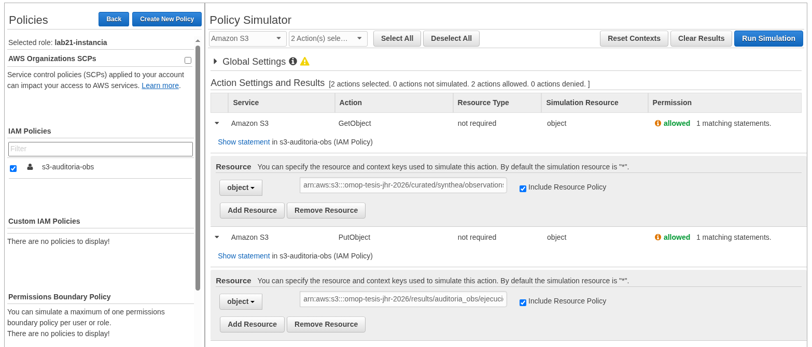
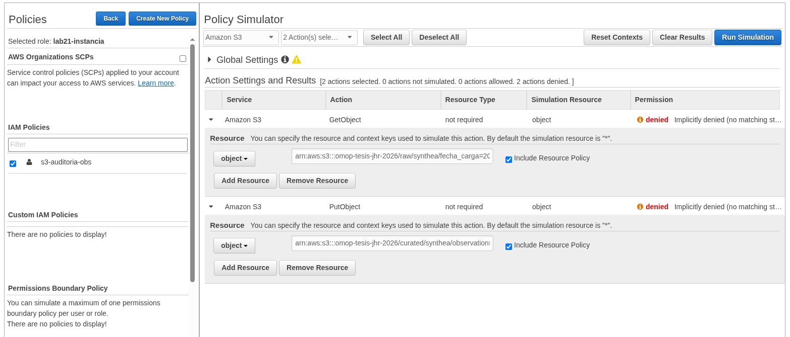
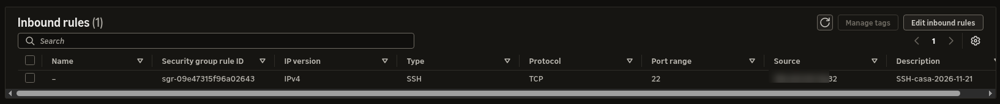

# Laboratorio 21: ejecutar un análisis en la nube con EC2

**Región:** `us-east-2` (la misma del bucket `omop-tesis-jhr-2026`)
**Pipeline:** auditoría de plausibilidad de `observations` con `clinlab` ([pipeline/](./pipeline/))
**Instancia:** `t3.small` con créditos `standard`

Las decisiones están justificadas en [DECISIONES.md](./DECISIONES.md).

---

## 1. Justificación de la instancia y tipo elegido

**Memoria.** El pipeline usa un pico de **0.80 GiB** (803–806 MiB en 3 corridas, *Maximum resident set size* de `/usr/bin/time -v`). Lo sé porque lo medí, no porque lo estimara. Leer la tabla completa (10 columnas, 5.7 M filas) usaba unos 3.0 GiB. Leer solo 6 columnas y filtrar los 6 códigos en Arrow antes de pasar a pandas (*projection* y *predicate pushdown*: 508 322 filas) lo redujo casi 4 veces. Si sumo unos 300–400 MiB del sistema y unos 100 MiB del demonio de Docker, la instancia necesita alrededor de 1.3 GiB.

**Tiempo en la laptop.** Son entre 19 y 37 s leyendo desde S3 (3 corridas), de los que el cálculo es solo unos 3 s: el resto es la latencia de 110 peticiones HTTP desde casa hasta `us-east-2`, el mismo *small files problem* medido en el lab 20. Con los datos en disco local, la tabla completa se audita en 2.9 s.

**¿Por qué EC2?** Siendo honesto, **mi laptop alcanza de sobra** (16 núcleos y 46 GiB de RAM frente a 0.8 GiB necesarios). Por perfil, el trabajo encaja mejor en **Lambda** (menos de un minuto y menos de 1 GiB, dentro de sus límites de 15 min y 10 GB, y se paga por invocación) o en **Fargate** (un contenedor sin servidor que administrar). **Batch** sobra: sirve para orquestar muchos trabajos en cola. Uso EC2 porque el laboratorio también necesita una máquina interactiva (Jupyter por túnel SSH, `tmux`) y porque es la base para entender a los otros servicios. EC2 se justificaría de verdad si los datos crecieran hasta no caber en memoria en la laptop, o si la corrida durara horas.

**Tipo elegido: `t3.small` (2 vCPU, 2 GiB) con créditos `standard`.** `t3.micro` (1 GiB) no deja margen para unos 1.3 GiB. `c7i-flex.large` (4 GiB) cuesta 4 veces más ($0.0848 frente a $0.0208 por hora on-demand en `us-east-2`) para una memoria que no necesito. El trabajo es corto, así que no agota los créditos de CPU. Aun así elegí el modo `standard` (que frena) en lugar del `unlimited` por defecto (que cobra el excedente), para que el costo sea predecible. Detalle en [D2](./DECISIONES.md#d2-tipo-de-instancia).

## 2. Rol IAM de privilegio mínimo y evidencia del simulador

Rol **`lab21-instancia`**, con un *instance profile* del mismo nombre (es lo que EC2 recibe en realidad). Ninguna política administrada: ni `AmazonS3FullAccess` ni ninguna otra. Decisión: [D5](./DECISIONES.md#d5-alcance-del-rol-de-la-instancia-lab21-instancia).

**Confianza** ([iam/rol_confianza.json](./iam/rol_confianza.json)): solo el servicio `ec2.amazonaws.com` puede asumir el rol.

**Permisos** (inline `s3-auditoria-obs`, [iam/rol_permisos.json](./iam/rol_permisos.json)):

```json
{
  "Version": "2012-10-17",
  "Statement": [
    {
      "Sid": "ListarSoloLosDosPrefijosDelPipeline",
      "Effect": "Allow",
      "Action": "s3:ListBucket",
      "Resource": "arn:aws:s3:::omop-tesis-jhr-2026",
      "Condition": {
        "StringLike": {
          "s3:prefix": ["curated/synthea/observations/*", "results/auditoria_obs/*"]
        }
      }
    },
    {
      "Sid": "LeerSoloObservations",
      "Effect": "Allow",
      "Action": "s3:GetObject",
      "Resource": "arn:aws:s3:::omop-tesis-jhr-2026/curated/synthea/observations/*"
    },
    {
      "Sid": "EscribirSoloResultadosDeEstePipeline",
      "Effect": "Allow",
      "Action": "s3:PutObject",
      "Resource": "arn:aws:s3:::omop-tesis-jhr-2026/results/auditoria_obs/*"
    }
  ]
}
```

`ListBucket` se aplica al **bucket** (ARN sin `/`) y se acota con `s3:prefix`; `GetObject` y `PutObject` se aplican a **objetos** (`…/prefijo/*`).

### Evidencia del simulador

**1. Política aislada (CLI, `simulate-custom-policy`)**, con [iam/simular_rol.sh](./iam/simular_rol.sh): 12/12 casos según lo esperado.

| Debe poder | | No debe poder | |
|---|---|---|---|
| Listar `curated/synthea/observations/` | allowed | Listar la raíz del bucket | implicitDeny |
| Leer un Parquet de `observations` | allowed | Listar `raw/` | implicitDeny |
| Escribir en `results/auditoria_obs/…` | allowed | Leer `raw/…/patients.csv` (PII simulada) | implicitDeny |
| Listar `results/auditoria_obs/` | allowed | Leer otra tabla de `curated/` | implicitDeny |
| | | Escribir en `results/otro/` | implicitDeny |
| | | Escribir en `curated/` (alterar la fuente) | implicitDeny |
| | | Borrar un resultado | implicitDeny |
| | | Leer otro bucket | implicitDeny |

**2. El rol real en el simulador de la consola** (`policysim.aws.amazon.com`, rol `lab21-instancia`, **casilla "AWS Organizations SCPs" desmarcada**):

- Permitido (GetObject en `observations/`, PutObject en `results/auditoria_obs/`): 
- Denegado (GetObject en `raw/…/patients.csv`, PutObject en `curated/…`): 

En ambas capturas, la columna *Simulation Resource* dice `object`, es decir, se evaluaron los ARN escritos y no el comodín `*` por defecto. Un primer intento se descartó porque mostraba `*`: con el comodín, "allowed" no demuestra nada sobre un prefijo concreto. Con "Include Resource Policy" marcada, también se evalúa la política del bucket (solo HTTPS).

**Por qué hay que desmarcar las SCP (el mismo hallazgo del lab 19).** La cuenta del Plan Gratuito por Proyectos pertenece a una organización de AWS Organizations gestionada por AWS. Con las SCP incluidas, el simulador responde `explicitDeny` con `AllowedByOrganizations: false` **a todo**, incluso a acciones que en la realidad funcionan: simulando a `jorge-labs`, `s3:GetObject` da `explicitDeny`, pero un `head-object` real devuelve el objeto. Es un falso negativo de la capa organizacional, que el simulador no puede evaluar desde una cuenta miembro (tampoco se pueden leer las SCP: `ListPoliciesForTarget` da `AccessDenied`). Por eso, `simulate-principal-policy` de la CLI, que siempre incluye las SCP, no sirve en esta cuenta.

**3. Prueba real desde la instancia:** _pendiente (actividades 5 y 6)_. Es la prueba definitiva, porque atraviesa todas las capas, SCP incluidas.

## 3. Instancia y grupo de seguridad

**Instancia:** `i-02b9031d83a69fcd8`, `t3.small` con `CpuCredits=standard`, región `us-east-2` (zona `us-east-2c`). AMI Amazon Linux 2023 (`ami-0bdaca0026bed499d`, D3). Disco raíz de 8 GB `gp3`, cifrado y con `DeleteOnTermination`. Rol `lab21-instancia` por instance profile (actividad 2). IMDSv2 obligatorio con *hop limit* 2 (D4).

**Grupo de seguridad:** `lab21-ssh-mi-ip` (`sg-01a648f8275af9e48`). Una sola regla de entrada: SSH (TCP 22) con origen **mi IP pública como `/32`**, es decir, una sola dirección, con la descripción `SSH-casa-2026-11-21`. No hay regla para el 8888 (Jupyter) ni para ningún otro puerto: Jupyter escucha solo en `127.0.0.1` y se alcanza por túnel SSH (D6). La salida queda abierta (valor por defecto) porque la instancia necesita llegar a S3, a ghcr.io y a los repositorios de `dnf`.



*La captura muestra la única regla de entrada del grupo `lab21-ssh-mi-ip`: SSH, TCP 22, origen un `/32` (difuminado a propósito) y la descripción `SSH-casa-2026-11-21`. No aparece `0.0.0.0/0`.*

**Si cambia mi IP** (la de casa no es fija): SSH deja de responder (*timeout*, no "permission denied"). Se corrige editando el origen de la regla; no se abre el 22 al mundo.

## 4. Script de `user data`

El script completo está en [ec2/user_data.sh](ec2/user_data.sh). `cloud-init` lo ejecuta **una sola vez**, como root, en el primer arranque. Hace cinco cosas, en orden:

1. Instala `docker`, `tmux` y `python3.12` con `dnf` (sin `dnf upgrade`, para que la máquina sea reproducible: la AMI fija la versión del repositorio).
2. Activa Docker ahora y en cada reinicio, y mete a `ec2-user` en el grupo `docker` (así lo usa sin `sudo`).
3. Descarga la imagen pública `ghcr.io/jorgehre/auditoria-obs:0.2.0` (pull anónimo: no hay ningún token en la máquina, D10).
4. Crea un venv con JupyterLab 4.6.6, pandas 3.1.1 y pyarrow 26.0.1, de versiones fijas (D6). Aún no lo arranca: eso es la actividad 7.
5. Escribe `~/LISTO.txt` con las versiones instaladas. Si ese archivo existe, el script terminó sin errores.

**Decisiones de diseño:**
- `set -euxo pipefail`: `-e` detiene el script al primer error (sin eso, un `dnf` fallido pasaría inadvertido y el script "terminaría bien" con la máquina a medias); `-x` imprime cada comando en el log, y esa es la evidencia.
- **Sin credenciales** en el script: el `user data` se puede leer desde la consola y desde IMDS. Los permisos los da el rol.
- **Regla del lab:** si algo falla, se corrige este archivo y se relanza la instancia. No se arregla a mano por SSH, porque entonces la máquina deja de ser reproducible.

**Evidencia:** [ec2/evidencia_user_data.txt](ec2/evidencia_user_data.txt), extraída de `/var/log/cloud-init-output.log`. Muestra cada comando ejecutado y `cloud-init status: done`, y confirma que terminó en 6.5 min sin errores (Docker 25.0.14, AWS CLI 2.38.0, tmux 3.6a, JupyterLab 4.6.6, imagen de 438 MB, disco 3.1 de 8 GB usados).

## 5. Ejecución del pipeline: de S3 a S3

Se ejecutó dentro de la instancia, por SSH, con la imagen publicada y sin pasarle ninguna credencial:

```bash
docker run --rm ghcr.io/jorgehre/auditoria-obs:0.2.1
```

El contenedor obtiene las credenciales del rol `lab21-instancia` por IMDSv2 (por eso el *hop limit* es 2, D4). Salida completa en [ec2/evidencia_act5.txt](ec2/evidencia_act5.txt).

| | En mi laptop (act. 1) | En la instancia |
|---|---|---|
| Filas leídas | 508 322 | 508 322 |
| Implausibles / duplicados | 748 / 164 | 748 / 164 |
| Tiempo del pipeline | 19–37 s | 9.8–10.4 s |

Los resultados son idénticos, así que correr en la nube no cambió el análisis. Es más rápido porque la instancia está en la misma región que el bucket (`us-east-2`) y la lectura de S3 va por la red interna de AWS. La salida quedó en `s3://omop-tesis-jhr-2026/results/auditoria_obs/ejecucion=<sello>/auditoria.parquet` (614 filas × 10 columnas); cada corrida usa su propio prefijo y nunca pisa una anterior.

**Pruebas del rol desde la instancia:**

| Intento | Resultado | Qué demuestra |
|---|---|---|
| Leer `curated/synthea/observations/` y escribir en `results/auditoria_obs/` | permitido (el pipeline) | hace su trabajo |
| `aws s3 ls` de `results/auditoria_obs/` | permitido | puede ver sus resultados |
| `aws s3 ls` de `raw/` | `AccessDenied` (`s3:ListBucket`) | no ve datos crudos |
| `aws s3 rm` de un resultado propio | `AccessDenied` (`s3:DeleteObject`) | puede escribir, no destruir |
| Escribir en `results/otro/` | `AccessDenied` (`s3:PutObject`) | solo escribe en su prefijo |

Esta es la prueba definitiva que quedó pendiente en §2: atraviesa todas las capas, incluidas las políticas de la organización, que el simulador no ve.

**Un fallo en el camino (D12):** la primera corrida con la imagen `0.2.0` dio `AccessDenied` en un `HeadObject`. pyarrow consulta la llave `curated/synthea/observations` (sin barra) antes de listar, y esa consulta no envía `s3:prefix`, así que la condición de `ListBucket` no se cumple y S3 responde 403. Se corrigió el **código** (listar con barra final) y no la política, para no ampliar lo que el rol puede ver; de ahí la imagen `0.2.1`.

## 6. Demostración de que no hay credenciales en la máquina

Salida completa, con el ID de cuenta sustituido por `<ID-CUENTA>`: [ec2/evidencia_act6.txt](ec2/evidencia_act6.txt).

| Comprobación (dentro de la instancia) | Resultado |
|---|---|
| `~/.aws/credentials` y `~/.aws/config` | no existen (`~/.aws` solo tiene `cli/cache/session.db`) |
| Variables de entorno `AWS_*` | ninguna |
| Búsqueda de `AKIA…`, `ASIA…` y `aws_secret_access_key` en todo el home | 0 archivos |
| Variables `AWS_*` dentro de la imagen del contenedor | 0 |
| `aws sts get-caller-identity` | responde |

```json
{ "UserId": "AROA…:i-02b9031d83a69fcd8",
  "Arn": "arn:aws:sts::<ID-CUENTA>:assumed-role/lab21-instancia/i-02b9031d83a69fcd8" }
```

El `Arn` es de un **rol asumido** (`assumed-role/lab21-instancia/…`), no de un usuario IAM (`user/…`), y el `UserId` empieza por `AROA` (rol), no por `AIDA` (usuario).

**De dónde salen y por qué caducan:** la CLI y pyarrow las piden al servicio de metadatos de la instancia (IMDSv2, `169.254.169.254`), que obtiene de STS credenciales **temporales** del rol `lab21-instancia`; son de tipo `AWS-HMAC`, emitidas a las 01:50:06 UTC y con expiración a las 08:06:29 UTC (unas 6 horas), y AWS las renueva sola antes de que venzan. Una copia robada deja de servir cuando caduca, y no hay nada permanente que rotar o revocar.

**Dos matices honestos:**
- La búsqueda de llaves incluye los archivos binarios solo en la revisión de `session.db` (`grep -a`); la general usó `-I` y los omite. `session.db` es una base SQLite de la CLI con un identificador de sesión y de host, y 0 coincidencias de llaves.
- `gitleaks` sobre el repositorio (214 commits) reporta 2 hallazgos, ambos **falsos positivos del lab 8** (un `pageToken` ya marcado `REDACTED` en `s08-apis-rest-consumo/.../act5_verificacion.txt`). No hay ninguna llave AWS ni nada del lab 21.

## 7. Jupyter por túnel SSH
_Pendiente (actividad 7)._

## 8. Trabajo que sobrevive a la desconexión (`tmux`)
_Pendiente (actividad 8)._

## 9. Spot frente a on-demand
_Pendiente (actividad 9)._

## 10. Alarma de apagado, evidencia de apagado y costo medido
_Pendiente (actividad 10)._

---

## Criterios de evaluación

- [ ] Ninguna credencial de AWS está almacenada en la instancia (demostrado)
- [ ] El puerto 22 no está abierto a `0.0.0.0/0`
- [ ] Jupyter nunca estuvo expuesto a internet
- [ ] El rol de instancia es de privilegio mínimo, no `AmazonS3FullAccess`
- [ ] El `user data` deja la máquina lista sin intervención manual
- [ ] El pipeline lee y escribe en S3, no en el disco de la instancia
- [ ] La instancia quedó terminada o detenida al final
- [ ] Hay una alarma de apagado automático configurada
- [ ] El costo reportado viene de Cost Explorer, no de una estimación
- [ ] Cero credenciales en el repositorio (`gitleaks` limpio)
